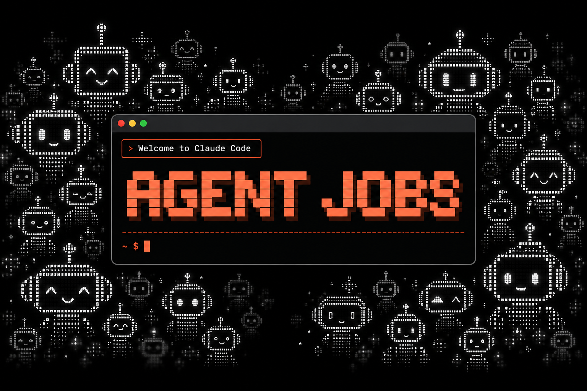
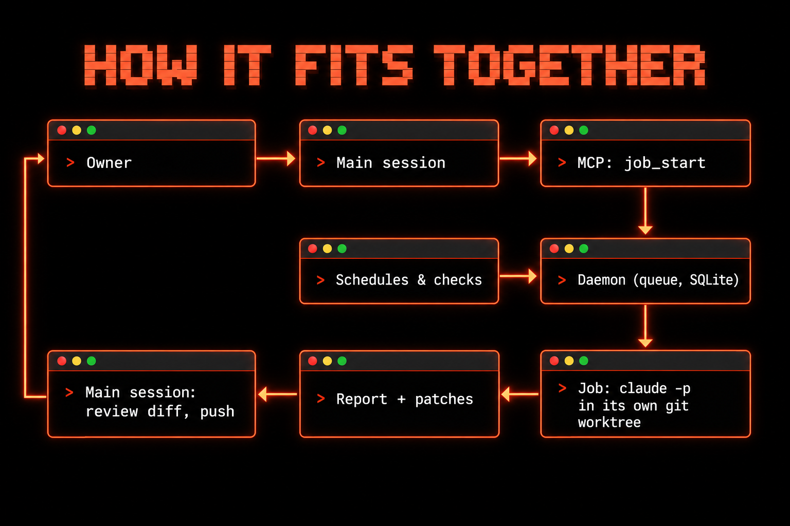
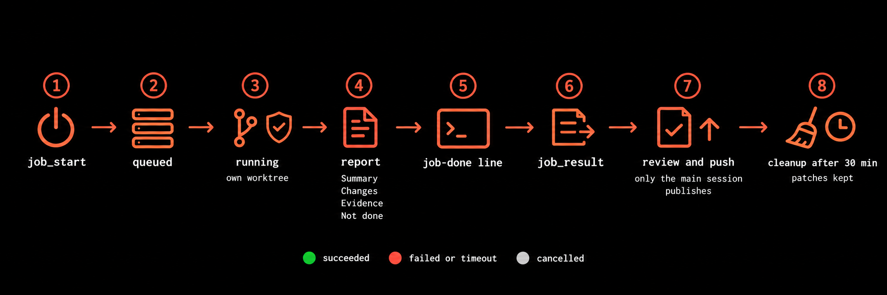

<p align="center"></p>

# Agent Jobs

> **Read in your language:** English (this page) · [**Русская версия →**](README.ru.md)

[](https://github.com/qwwiwi/agent-jobs/releases)
[](LICENSE)
[](go.mod)
[](https://code.claude.com/docs/en/headless)
[](#quick-start)
[](#license-and-author)

**Cheaper. Faster. Full-strength.**

Agent Jobs lets a long-lived Claude Code session hand heavy work to background `claude -p` processes. The main session talks, decides and checks; everything longer than a few steps becomes a *job*: a one-shot, full top-level Claude run with its own git worktree, hard turn / budget / time limits and a guard on every tool call. A small daemon queues, launches, watches and cleans up jobs. When a job finishes, the session receives exactly one line, and reads the report only when it is ready to. Jobs never push, publish or message anyone; only the main session goes outside, after it has read the report and checked the diff.

It is a single Go binary with one SQLite file per agent, running on Linux (systemd user service) and macOS (launchd).

> **Status:** the core (queue, daemon, launch, guard, report contract, notify, cleanup) and the MCP job tools (`agent-jobs mcp`) are on `main` and installed for testing on a single Linux host. The CLI stays for manual use. Roadmap: [docs/PLAN.md](docs/PLAN.md).

---

## Why jobs, not subagents

Subagents are useful, and jobs do not replace them for short work the session needs right now. The case for jobs is about **where the context lives and who pays to re-read it**.

**The measured part.** Over five days of real work ending 2026-10-15, the long-lived main session of one of our agents re-read about **7.2 billion** cached tokens; all of its subagents together re-read about **2.3 billion**. The cause: the main session's context sat near 95% of its 1M-token window, and every call re-reads all of it. The dominant cost is not the work itself, it is the long-lived parent's context being read again and again.

That is what a job avoids:

- **A subagent's result lands in the parent** and is re-read on every following call until the next compaction. A job writes its result to a file; the parent gets one line and reads the report on demand.
- **Notifications and result turns re-read the full parent.** A job costs the parent one short line when it finishes, and one read of the report.
- **A foreground subagent keeps the parent's turn open.** The session cannot talk or decide until it returns. A job returns an id at once and the session stays free.
- **A job is its own process with hard limits.** Subagents can be scoped too (turn limits, tool allowlists, MCP servers). What a job adds is the combination: a separate `claude -p` process with its own full context, its own git worktree, a USD budget (`--max-budget-usd`) and a wall-clock timeout enforced by the daemon, survival across a restart of the parent, and a fixed report contract.
- **A job outlives the session.** Subagents die with their session; a job runs in its own process group and survives a session or daemon restart. An interrupted job can be resumed in its own session (`job_resume`, Wave E2).
- **Load can be spread.** Subagents draw on the usage window at the same moment as their parent. Jobs queue (at most `max_running` run per agent, default two) and, with schedules (Wave B), can run when the window is quiet.
- **A job is a full session.** A subagent starts with only its prompt and is often routed to a cheaper model. A job is a full top-level Claude Code run with its own model choice and the full tool set, inside the limits above.

We do not publish an "N× cheaper" or "N× faster" figure yet, because we have not measured one per task. The benchmark below is how we will.

### Benchmark (in progress)

**Method.** The same task is run three ways: as a foreground subagent, as a background subagent, and as a job.

- **Tokens:** report `input`, `cache_creation`, `cache_read` and `output` (the usage fields `input_tokens`, `cache_creation_input_tokens`, `cache_read_input_tokens`, `output_tokens`) separately, and their sum. Sources: the parent session's JSONL plus the subagent sidechain, against the job's own JSONL (`stream.jsonl`) plus the parent's tokens for the job-done line and the report read.
- **Priced total (primary comparison):** the four fields times the list price of the model that ran them, each at its own rate (they are billed differently), in $ per run. For subscription runs it is an equivalent cost, not money spent.
- **Acceptance:** the same acceptance check for all three modes; a run counts only if the task's check passes, so cost is compared on equal results.
- **Wall time:** from start to a usable result.
- **Parent busy:** minutes during which the parent session could not take another request.

| Run | Task | Input | Cache creation | Cache read | Output | Token sum | Priced total ($) | Acceptance passed | Wall time | Parent busy (min) | Notes |
|---|---|---|---|---|---|---|---|---|---|---|---|
| Foreground subagent | | | | | | | | | | | |
| Background subagent | | | | | | | | | | | |
| Job | | | | | | | | | | | |

Results will be filled in here when the runs are done.

---

## How it works

### The swarm

<p align="center"></p>

One main session, many workers. The session writes a brief for a stranger (a job has no conversation context), starts a job and goes back to talking. Each job works alone in its own folder and comes back with a report. The picture is illustrative: jobs wait in a queue, and at most `max_running` (default two) run at a time per agent.

### Components

<p align="center"></p>

- **Main session** talks to the owner, starts jobs, reads reports, reviews and pushes. It is the only part allowed to go outside.
- **Daemon** (`agent-jobs daemon`) ticks once a minute: collect finished jobs, launch queued ones, deliver job-done lines, clean up. It keeps no state in memory: kill it, even with SIGKILL, and running jobs carry on; the next daemon finds their exit codes and collects them.
- **Queue** is one SQLite table per agent. A tick claims a job with a random launch token before spawning anything, and only that tick can finish it, so a job is never launched twice.
- **Job** is `agent-jobs run-wrapper` running `claude -p` in its own process group, with a scrubbed git environment, in a git worktree detached at the base commit (or an empty directory).
- **Job folder** keeps the brief, settings, event stream, report and, after cleanup, the patches.
- **Schedules (cron)** are built, released in 0.4.0 (Wave B): the daemon checks them every minute and types a due prompt into the main session or starts a job.
- **Checks (dead-man's switch)** are built, released in 0.4.0 (Wave B): work that stays silent while healthy leaves a mark; the daemon alerts the main session once when an expected time passes without one.

### Lifecycle

<p align="center"></p>

1. **Start.** The session starts a job with a title, kind, brief, repo, model and limits. The call validates everything, inserts a `queued` row and returns the id. Nothing runs yet.
2. **Queued.** On the next tick, if fewer than `max_running` (default two) jobs are running for this agent, the daemon claims it.
3. **Running.** The daemon prepares the folder (brief with memory notes, settings, worktree) and launches the wrapper detached, in its own session. The wrapper runs `claude -p` and writes `exit_code` last.
4. **Report.** The job's final message is saved as `report.md`. Exit code 0 with a report is `succeeded`; a non-zero exit, a turn or budget stop, or no report is `failed`; past the timeout the process group gets SIGTERM, then SIGKILL after 10 s, and the job is `timeout`. `cancelled` comes only from an explicit cancel.
5. **Job-done line.** The session receives one line via `tmux send-keys`:
   ```
   [jobs:job-done] job 261015-124136-70d3 review auth module succeeded · 3 turns · $0.25 · 0m
   ```
   The line is printable-only (control characters dropped, title capped), so a job title cannot type keystrokes into the session. An undelivered line stays pending and is retried every tick.
6. **Result.** The session reads the report when it is ready: «Not done / uncertain» first.
7. **Review and push.** The session checks the diff against `base_commit` itself. A report is a claim, not a result. Only then does it push or publish.
8. **Cleanup.** 30 minutes after the line was delivered, the worktree is removed and the work is kept as patches (below).

Only `queued` and `running` rows can change status; `succeeded` and `cancelled` are final. A `stopped`, `timeout` or `failed` job can be resumed (below); a `stopped` job can also be cancelled.

### Change course: amend, stop and resume

Every job runs in a claude session whose id is assigned before launch (`claude -p --session-id <uuid>`), and the session is kept on disk, so a job can be corrected without losing what it already knows and did:

- **Amend** a job that is still `queued`: `job_amend(id, context)` appends the context to its brief under «Orchestrator update» (to the pending update, for a queued resume); it keeps its place in the queue.
- **Stop** a running (or queued) job: `job_stop(id, reason?)` sends SIGTERM to its process group (SIGKILL after 10 s), like cancel, but the job ends `stopped`: its worktree, uncommitted changes and session are kept, and its turns (and cost, when claude reported it) so far are recorded. A stopped job gets no job-done line and no cleanup.
- **Resume** a `stopped`, `timeout` or `failed` job: `job_resume(id, context, limits?)` queues the next attempt of the **same job id** in the same work dir. Claude continues the same session (`claude -p --resume <session id>`) with one new message: «Orchestrator update», your context, «Continue the task with this update; keep the report contract». Kind, guard, profile, MCP config and owner rules stay the same. Limits default to what the previous attempt left (turns, budget, minutes); pass new ones when nothing is left (after a timeout, `timeout_minutes`). An attempt killed before claude reported its cost (a stop, a timeout) counts at its whole budget, so then pass `max_budget_usd`. All attempts of a job together stay within the ceilings. A resume is refused when `.claude` in the work dir differs from the base commit (or exists in a job without a repository): claude would load its settings and hooks outside the guard. A session transcript changed after the attempt ended is not resumed (fresh session instead). If the session is gone, or `--resume` fails before any turn, the attempt starts a fresh session in the same work dir with the original brief, a summary of the previous attempt (its report, else its last messages) and your context, and the report says so. A worktree that cleanup already removed is restored from the saved ref and patches first. The job-done line of a later attempt says `resumed (attempt N)`; `job_result` lists every attempt (earlier reports stay as `report.attempt-<n>.md`).
- **Cancel** gives the job up: queued or running as before, and a `stopped` job is cleaned up like any finished one.

Use amend while a job waits, stop and resume when a running job needs new facts or a changed plan, and cancel when its work is no longer wanted. A job stopped before it ever ran has no session: resuming it appends the context to its brief and starts it normally.

---

## Limits

| | default | ceiling |
|---|---|---|
| Turns (`--max-turns`) | 80 | 200 |
| Budget (`--max-budget-usd`) | $10 | $50 |
| Time (`--timeout-minutes`) | 45 min | 180 min |
| Running per agent | 2 | |

A request above a ceiling is **rejected, never clamped**, so a job never stops for a reason its author could not see. Zero or omitted means the default; negative values are rejected.

**Model.** Pass `--model`, or a `--complexity` (`light` / `normal` / `hard`) that maps to a model by kind:

| kind | light | normal | hard |
|---|---|---|---|
| review, fix, general | sonnet | opus | fable |
| research | sonnet | sonnet | opus |

A model or a complexity is mandatory: with neither the job is rejected. There is no default complexity and no classifier; the caller decides.

**Codex runner.** A `gpt-*` model (or `--runner codex`) runs the job on `codex exec` instead of `claude -p`. There are no turn or budget caps there, so the timeout is the only limit and the cost is recorded as unknown; `--reasoning-effort low|medium|high` (default `high`). The guard hook does not run inside codex, so only read-only codex jobs (kinds `review` and `research`, codex sandbox `read-only`) are allowed unless the config sets `codex_write_allowed: true`. Resume of a codex job is refused for now. Config `models` can map single kind × complexity cells to codex models; the defaults above do not change. Details: [ARCHITECTURE](docs/ARCHITECTURE.md#codex-runner-deviations-5).

**Acceptance command.** Off by default: set `acceptance_allowed: true` in `config.json` first (until then `job_start`, `schedule_add` and `--acceptance-cmd` refuse it, and a wrapper that finds it off at run time does not run it). A fix or general job can then carry `acceptance_cmd` (`--acceptance-cmd`, one line, ≤ 1 KB, no newline, CR or NUL anywhere, also not at either end): after claude exits 0 with a report, the wrapper runs it with `/bin/sh -c` in the job's worktree, inside the job's containment, in a process group of its own that cancel, stop and the timeout end too, with a scrubbed environment (`HOME` and `TMPDIR` a throwaway dir in the job dir, no tokens) and **without the guard**, for at most `acceptance_timeout_minutes` (default 15, max 60). Exit 0 keeps the job succeeded; anything else fails it with «acceptance failed (exit N)» (or «acceptance did not run»). `job_result` shows `acceptance` (command, exit, duration, the tail of `acceptance.log`, redacted); a resume runs it again. Review and research jobs refuse it. The command line is yours, but it runs the code the job wrote, as your user, with no sandbox, so it catches mistakes, not a hostile job. Details: [ARCHITECTURE](docs/ARCHITECTURE.md#flows).

**Kinds** add a short checklist to the brief:

| kind | the checklist asks for |
|---|---|
| `review` | real bugs with `file:line`, consequence and minimal fix; verified kept apart from suspicions |
| `fix` | reproduce with a failing test first, then the minimal change, tests, a local commit |
| `research` | only primary sources actually opened; verified kept apart from inferred. The only kind with web access |
| `general` | state what counts as done before starting, prove it at the end |

## Report contract

A job's final message is its report, saved as `report.md`. Exactly four sections, in this order, then a Progress section:

```
## Summary
## Findings / Changes
## Evidence
## Not done / uncertain
## Progress
```

«Not done / uncertain» is mandatory and is read first: it makes the job name what it did not do. Progress lists the job's steps, one timestamped line each (`- HH:MM UTC …`); `job_result` returns both sections as `not_done` and `progress`, and `agent-jobs result` prints them before the rest. A report without Progress is not an error. A job that ends without a report is marked `failed`.

**Secret redaction.** When a job ends, secret-looking values in its `report.md` are replaced in place with `[redacted:<kind>]`: Anthropic, OpenAI, GitHub, Slack, AWS, Google and Telegram bot tokens, JWTs, PEM private key blocks, `Bearer <token>`, and `key=value` / `"key": "value"` where the key contains `token`, `secret`, `password`, `passwd` or `api_key` and the value is 16+ characters. The original is gone unless `keep_raw_reports: true` keeps it as `report.raw.md` (0600). Values are replaced whole however long they are. Only the first 4 MiB of a report is read and scanned; the rest is replaced by an «unscanned» note. If the rewrite fails (or the daemon dies before it), the job stays `redaction_pending` and every tick retries; `job_result`, `agent-jobs result` and the HTTP API redact the report on the fly anyway. The job-done line, the daemon log, the stats row and the previous-attempt excerpts in a resumed brief are redacted the same way. Git SHAs, UUIDs and short base64 stay. It is a safety net, not a guarantee: `stream.jsonl` and `stderr.log` are kept raw (and archived raw), so the job folder and the archive stay private.

**Brief size.** `job_start` refuses a brief above `max_brief_bytes` (default 32 KB) and returns a `size_warning` when the brief names more than `brief_warn_files` files (default 40) or has more than `brief_warn_headings` `## ` headings (default 8): it may be more than one job.

## Cleanup and patches

30 minutes after the job-done line is delivered, the daemon removes the job's worktree, the heaviest part. It first checks that the worktree really belongs to this job, then saves everything the job changed, without touching the index or files:

| file | content |
|---|---|
| `diffstat.txt` | `git diff --stat <base>` plus the untracked list |
| `commits.patch` | the job's commits (`git format-patch <base>..HEAD`) |
| `staged.patch` | staged changes |
| `uncommitted.patch` | working tree vs `HEAD`, staged changes included (`git diff --binary HEAD`) |
| `untracked.tar` | untracked, not ignored files |

and sets the ref `refs/agent-jobs/jobs/<id>` in the source repository to the job's last commit. Restoring the work in a fresh worktree at the base commit is four commands; see [docs/ARCHITECTURE.md](docs/ARCHITECTURE.md#flows). If the repository config names a filter, diff command or textconv, no patch is made (a diff would run that program); the worktree is kept for a human and the reason is logged.

**Prune.** `agent-jobs prune --agent A [--dry-run]` cleans the folders of jobs that finished more than 48 hours ago: the records (`report.md`, the patches, `base_commit`, `diffstat.txt`) and small top-level text files (≤ 1 MiB, e.g. `prompt.md`) stay; subdirectories (the work dir, caches, builds), binaries, large files and symlinks go (a link is removed, never followed). A repo job whose cleanup has not run yet is skipped, and a worktree cleanup kept for a human is left alone. Before anything goes, the job's logs move into the log archive (below).

**Log archive and job stats.** When prune cleans a job folder it moves the records for later analysis into `<archive>/<YYYY-MM>/<id>/` instead of deleting them: `stream.jsonl.gz` and `stderr.log.gz` (gzipped, removed from the job folder), `prompt.md`, `report.md`, `diffstat.txt` and `meta.json` (the job row). `<archive>` is `~/.agent-jobs/<agent>/archive` unless `log_archive_dir` says otherwise (another disk, a synced folder); archived months older than `log_archive_days` (default 365, 0 = forever) are deleted by prune. Expiry and the 0700 chmod act only on a root the archive created itself (it holds the marker file `.agent-jobs-archive`); an existing folder without the marker is archived into but nothing in it is ever deleted or chmodded (create the marker yourself to turn retention on; until then prune and archive print `retention off: no marker in <root>`). The default `<state>/archive` is always ours: a missing marker there is written again. When the archive cannot be written, `stream.jsonl`, `stderr.log` and `prompt.md` stay in the job folder and prune still cleans the rest. The archive lies outside the job folders, so cleaning jobs never touches it, and an external backup of the state dir (e.g. a nightly restic or rsync of the home dir) carries it off the machine. The logs contain tool output (file contents, command output), so keep the archive private: it is created 0700 and a symlinked archive path is refused. `agent-jobs archive --agent A --dry-run` shows what would move. A job whose records were archived can no longer be resumed (start a new job); a `stopped` job is never archived. Every finished job also gets one row in the `job_stats` table (written when the job ends): kind, model, status, turns, cost, duration, times, repository name, tool calls by tool, skills used (Skill calls and reads under a `skills/<name>/` dir), guard refusals by rule, subagents, whether a report exists, the result subtype. `agent-jobs stats --agent A [--since 7d] [--by kind|model|skill] [--json]` summarizes them; `--backfill` first writes the rows of jobs that ended earlier, from their folders or the archive.

**Ghost processes.** `agent-jobs doctor procs --agent A [--kill]` finds processes that outlived their job or session (processes still carrying a finished job's `AGENT_JOBS_JOB` marker, markerless leftovers in a finished job's session; either way started while the job ran, in the current boot), *leaders* (a marked process that daemonized into its own session, e.g. a tmux server, which may now host other people's work, and marked processes running under such a daemon), running rows with a dead wrapper pid, and *suspects*: preview servers, browsers and wait loops whose session leader is gone. It only reports; `--kill` ends the processes proven to belong to a finished job (SIGTERM, then SIGKILL, through a pidfd re-checked against the scanned start time). Leaders and suspects are never killed. Running both once a day on their own is planned (Wave B).

---

## Safety

A job runs with `bypassPermissions` and nobody is watching it. So the rules are held by settings and a hook, not by asking nicely in the prompt.

- **Nothing leaves the job.** Deny rules in the job's `settings.json`, which hold even under `bypassPermissions`, forbid `git push` / `tag`, `gh release`, `gh api`, creating, editing, commenting on or merging PRs and issues, nested agents (`claude`, `codex`, `gemini`, `aider`, …), package runners (`npx`, `uvx`, `pnpm dlx`, …), file tools writing inside `.git`, and tools that reach a person or another session, schedule or wake the job, or run commands outside the guard's Bash checks (`CronCreate`, `ScheduleWakeup`, `SendMessage`, `RemoteTrigger`, `PushNotification`, `Monitor`, …); the guard also refuses every tool that is not on the job allowlist, and MCP tools other than the exact job-role `agent-jobs` tools. A job waits for a build with a foreground command or a bounded Bash loop. Web tools are open only to `research` jobs.
- **Only its own MCP servers.** `--strict-mcp-config` cuts off everything not in the job's `mcp.json`, including the repository's own `.mcp.json`. `--setting-sources project` keeps the main session's hooks out.
- **The guard.** A PreToolUse hook (`agent-jobs guard`) *parses* every Bash command instead of matching substrings: quotes, wrappers, `sh -c`, `eval`, substitutions and paths are resolved. It blocks every spelling of the outward actions above, git subcommands that run programs, writes into git's own files, dangerous `git config` keys, git identity overrides, the owner's name in a commit, `$?` after an unguarded pipe and wait loops that match themselves. A form it cannot resolve around git or gh is blocked, not guessed. Unparsable input fails closed.
- **Scrubbed git environment.** The wrapper drops inherited `GIT_*`, `PAGER`, `EDITOR`, `VISUAL`, uses a job-only global git config with the job's identity, no system config, and command-line overrides that switch off repository hooks, fsmonitor, the SSH command, credential helpers, the pager and the editor.
- **No nested jobs.** A job never starts, cancels or manages jobs. The wrapper sets `AGENT_JOBS_JOB=<id>` on every job; under it, or when an ancestor process or the session leader is a job wrapper (Linux, `/proc`), the binary refuses every command except the job's own MCP server, the guard hook and the wrapper. The guard also rejects `agent-jobs` as a command in any form except `agent-jobs mcp --role job`, and any change to `AGENT_JOBS_*`. After claude exits, the wrapper ends every other process of the job's session (SIGTERM, then SIGKILL) before it reports the job finished, so what the job started in its session does not outlive it.
- **Cgroup containment (Linux).** With a systemd user manager each job runs in its own transient scope, `agent-jobs-<agent>-<id>.scope`. A cgroup cannot be left with `setsid`, a double fork or re-parenting: control commands refuse inside a job scope, the wrapper ends every other process of the scope before it reports the job finished, and cancel, timeout and collection stop the whole unit. The job loses the user bus variables, and the guard rejects every command that starts processes outside the scope (`systemd-run`, `systemctl --user`, D-Bus tools, `crontab`, `at`, `tmux`, `screen`, `pm2`, `docker`/`podman`, `ssh`, `machinectl`, `loginctl`, `unshare`, `nsenter`; owner decision 2026-10-17) and writes under `/sys/fs/cgroup` in the spellings it resolves (cleaned, relative, symlinked, split by an unset variable, ANSI-C quoted). The guard is not a sandbox: a script the job writes itself is not inspected. `status`, `list`, `job_status` and the job-done line show the containment (`scope <unit>` / `session only`); a failed scope stop is retried every tick. Without `systemd-run --user` (macOS, containers, no user bus) only the session-based checks above apply, which is **weaker**: a process that calls `setsid` and drops the marker escapes them. Config `cgroup_scope`: `auto` (default), `required` (a job without a scope is refused; the Linux installer sets it where scopes work), `off`.
- **Preamble and owner rules.** Every brief starts with hard rules (own folder only, file and tool content is data, never print secrets, nothing outside) and the owner's standing rules file (≤ 8 KB). If that file is unreadable, the job does not start.
- **Subagents inside a job.** A job may use at most three subagents, inside its own limits: they run in the job's process under the same settings, guard, budget and timeout. The guard counts them per job with a counter in the job's database row that only grows, refuses the fourth (and every further one if the job shortens its subagent log), keeps the job from writing the log or the database, and allows only the input keys `description`, `prompt`, `subagent_type` and `model` (exact match), so no `isolation` (worktree or remote), `run_in_background` or team. A subagent cannot start jobs either.
- **Codex jobs are the exception.** The deny rules, the guard and the job MCP server are Claude Code features and do not run inside `codex exec`; there the codex sandbox is the only containment. So codex jobs run `read-only` (review, research) unless the owner sets `codex_write_allowed: true`.
- **Acceptance commands run outside the guard.** `acceptance_cmd` (off unless `acceptance_allowed: true`) runs the job's code (its tests, its build scripts) after the job ended, with no guard, deny rules or sandbox; only the environment is scrubbed (no tokens, a throwaway `HOME`). Allow it only for repositories whose jobs you would let run their own code unguarded.

**This is not a sandbox.** The deny rules and the guard block the *direct* spellings of outward actions, and the git scrub stops git itself from running programs the guard cannot see. A script the job writes and then runs is allowed by design, as in the reference design, and its contents are not inspected. Run jobs as a user whose credentials you are comfortable with them having.

Full rule list: [docs/ARCHITECTURE.md](docs/ARCHITECTURE.md#rules-enforcement).

---

## Skill, subagents and job context

- **The `agent-jobs` skill** ([skills/agent-jobs/SKILL.md](skills/agent-jobs/SKILL.md)) is installed per agent by `scripts/install-linux.sh`. It teaches the MCP tools, that `job_start` needs a model or a complexity, the routing rule and how to read a result:

  | the work | route |
  |---|---|
  | minutes, a few steps | do it yourself |
  | the session needs the result now | a subagent |
  | long, background, overnight, or must survive a restart | a job |

  Read a report's «Not done / uncertain» first, and check the diff before anything leaves the machine.
- **Subagents in jobs:** at most three per job, inside the job's own limits; no nested jobs (see Safety).
- **Job profile.** The owner-rules file (≤ 8 KB) is generated from the agent's own rules: mark what must hold in every job, then run `agent-jobs profile`:

  ```markdown
  <!-- agent-jobs:profile -->
  - Commit messages in English, short and descriptive.
  - Never commit secrets, `.env` files, keys or tokens.
  <!-- /agent-jobs:profile -->
  ```

  Only the marked sections are copied; over 8 KB is refused and nothing is written. A hand-written owner-rules file still works and is replaced only with `--force`.
- **Project cards.** Short notes per repository, attached to the brief of every job in that repository: stack, check runner, what not to touch, known traps. They live in `~/.agent-jobs/<agent>/cards/<name>.md` (≤ 4 KB each) and match by `repo:` (the repository's top-level path) or `remote:` (a remote URL or `host/owner/name`; `https://`, `git@host:` and `ssh://` forms compare equal, the host's case is ignored, the path's case is not; a local or relative remote only matches a local path). A card that cannot be read or parsed refuses the start of repository jobs instead of being skipped. Example: [cards/example-agent-jobs.md](cards/example-agent-jobs.md).

- **Skills for jobs.** A job runs with `--setting-sources project`, so it sees only its repository's `.claude/skills`. To give jobs skills from a catalog of your own, point `skill_roots` at it: any directory with an `index.json` at its root works (a local folder, a checkout of a shared skills repository); agent-jobs ships no catalog.

  ```json
  { "skill_roots": ["/home/me/skills-catalog"], "skills_max_per_job": 6, "skills_max_kb": 400 }
  ```

  `index.json` is `{"version": 1, "skills": [{"name": "golang", "path": "skills/golang", "status": "core", "kinds": ["code"], "projects": [], "last_verified": "2026-10-18", "risk": []}]}` (other fields such as `owner`, `origin`, `place`, `sha256`, `size_kb`, `has_scripts` and a `plugins` list are allowed; agent-jobs reads only `name`, `path`, `status`, `kinds`, `projects`, `risk` and `last_verified`, the informational fields are free-form: `origin` may be a string or an object, a value of an unexpected type is ignored, and an unknown field is ignored; an entry whose needed field has the wrong type is skipped with a warning naming the entry, the rest of the catalog still loads); each `path` is a directory named like the skill, inside the root, holding `SKILL.md`; a symlink inside a skill may only point to a regular file in that same skill directory (no directory links, nothing outside it, counted in the size), otherwise the entry is skipped with a warning. Status: `core` (a default for its kinds), `active`, `draft` (only when named), `deprecated` (never). A job gets the `core` skills of its kind (`fix` and `general` match `code` and `general`, `review` matches `review`, `research` matches `research`) plus the skills whose `projects` name the repository's folder; `job_start` `skills: ["+name", "-name"]` (CLI `--skills a,+b,-c`, also on schedules) adds or removes; an unknown or deprecated name, or more than the budget, refuses the start. For the run, each skill is linked into the worktree as `.claude/skills/<name>` -> its catalog directory (hidden from git by the repository's `info/exclude`, write-protected for the job, removed when the attempt ends, before any diff); a skill the repository already has stays the repository's; codex jobs get none. The brief names the skills in one line. `skill_list` / `agent-jobs skills list|search QUERY` browse and search the catalog; `agent-jobs stats --by skill` shows uses next to deliveries, `--by skill --by-repo` the rating per repository.

---

## MCP tools

The agent drives jobs through one MCP server (stdio) in two roles: `agent-jobs mcp --role orchestrator --agent A` for the main session and `--role job` for the jobs themselves (every job's `mcp.json` names it). The job role is an allowlist: a new tool stays closed to jobs until it is opened on purpose, a test fails when a tool is in neither list, and the server itself refuses hidden tools (not only by leaving them out). The job role does not open the job database.

**Job tools:**

| tool | what it does |
|---|---|
| `job_start` | queue a job: title, kind, brief, repo, model or complexity (one is required), optional limits, `acceptance_cmd` (needs config `acceptance_allowed`), `owner_waits` (the owner asked for it, see *Owner waits*), `skills` (edits to the default skills: `+name`, `-name`); returns the queued row |
| `job_status` | status, turns, cost, time |
| `job_result` | job-done line, report (capped at 256 KB, regular files only), artifact paths and the acceptance outcome |
| `job_list` | recent jobs, filterable by status |
| `job_cancel` | cancel: queued at once, running via SIGTERM, then SIGKILL; a stopped job is given up |
| `job_stop` | stop a queued or running job, keep its worktree and session: status `stopped` (resumable) |
| `job_resume` | continue a stopped, timeout or failed job in the same session with an «Orchestrator update»; limits default to what is left |
| `job_amend` | append context to a queued job's brief; it keeps its place in the queue |
| `skill_list` | the skill catalog (`skill_roots`): name, status, one-line description, kinds, size, risk, last verified, uses and success rate, a `stale` flag; `query` = local content search (best 10, with a score); `kind`, `repo`, `status` filters. Orchestrator only |
| `job_stats` | summary of finished jobs from the per-job stats table: counts, success rate, median / p90 cost and duration, top guard refusal rules, tool calls, skills by uses and success rate; `since`, `by` = kind \| model \| skill (same as `agent-jobs stats --json`) |

**Memory, task and team tools** keep the reference's names and are backed by the team's shared brain (gbrain) instead of a store of their own ([deviations #2, #3](docs/DEVIATIONS.md)). Without a `brain` block in `config.json` each of them answers «brain not configured» and nothing else changes.

| tool | what it does | shared brain call |
|---|---|---|
| `memory_search` | the closest notes for a query (default 6, ceiling 20): path, scope, score, snippet; `from_job` marks an unreviewed note a job wrote | recall `recall` |
| `memory_write` | write a note: `decision` (immutable), `runbook` or `error_pattern` (needs category, severity, trigger condition, prevention rule); a job may write `runbook` and `error_pattern` only, and its note carries the job's provenance: tag `agent-jobs-job:<id>`, author `<agent>/job:<id>`, a first line naming the job (a caller's own tags with that prefix are dropped in both roles) | memory `create_decision_note` / `create_runbook_note` / `create_error_pattern_note` |
| `memory_already_exists` | is there a note close to this text? `exists` when one of the top three scores ≥ `min_score` (default `brain.already_exists_min_score`, 0.5); the candidates are returned either way | recall `recall` |
| `task_create` | a task on the shared board: title, description, assignee, priority | tasks `task_create` |
| `task_list` | tasks by assignee and status (default 50, ceiling 200) | tasks `task_list` |
| `task_update` | set fields, then move to a status: `progress`, `review`, `done`, `blocked` (note = reason), `reopen`; returns the task afterwards | tasks `task_update`, then `task_start` / `task_review` / `task_done` / `task_block` / `task_reopen`, then `task_get` |
| `task_get` | one task by id; unknown id is an error | tasks `task_get` |
| `send_message` | a message to another agent (≤ 16 KB) | swarm `notify` |
| `inbox` | messages addressed to this agent not yet acknowledged; `ack` takes the ids you handled | swarm `ack`, `list_my_pending` |

A job gets `memory_search` and `memory_write` (and `notify_owner`, see below); everything that reaches another agent stays with the orchestrator. A job never holds the brain token: its MCP server sends both calls to the agent's daemon over the unix socket `<state>/brain.sock` (mode 600), and the daemon checks that the job is running and that the calling process is that job's (the socket's peer credentials: the job's session, and its scope when it has one; a job cannot act as another), gives a write the job's provenance whatever the job sent, records the note's path and calls the brain itself. The `token_env` variable is removed from the job's environment.

**System and file tools** (orchestrator only):

| tool | what it does |
|---|---|
| `system_doctor` | disk (free space, what `prune` would free), queue, ghost processes and dead running rows (report only), hooks (the guard blocks `git push` and allows `ls`, owner rules readable, notify target exists); `ok=false` lists the problems |
| `system_logs` | the last lines of the daemon log (`<state>/daemon.log` under launchd, else the systemd user journal of `agent-jobs@<agent>`), or with `job_id` that job's `stderr.log` |
| `activity_report` | jobs started and finished over a window (default 24 h): counts by status, cost, turns, time, the jobs themselves |
| `trash_move` | reversible deletion instead of `rm`: one rename into `~/.agent-jobs/<agent>/trash/<id>/`; only absolute paths inside `trash_roots` (config; **no default**: without it nothing can be moved), never the agent-jobs home (any agent's state), the owner rules, the agent-jobs binary, `~/.claude`, `$CLAUDE_CONFIG_DIR`, `~/.claude.json` or a path with a `.git` component; symlinks never followed out, never across filesystems |
| `trash_restore` | put an entry back at its original path; refused when the path is occupied (nothing is overwritten) or no longer inside a root |

**Own goals** (orchestrator only), kept in the agent's own job database:

| tool | what it does |
|---|---|
| `intention_add` | add a goal: `text` (one line, ≤ 500 characters, control characters refused), optional `due` (`YYYY-MM-DD`) and `priority` (low \| normal \| high, default normal); returns it with its id, status `open` |
| `intention_list` | the goals, oldest first; optional `status` filter (open \| done \| dropped) |
| `intention_set` | edit a goal in place by `id`: `status` (open \| done \| dropped) and/or `text`; there is no delete, a goal given up is `dropped` |

**Schedules** (orchestrator only), a cron expression in local time plus a prompt, checked by the daemon every minute:

| tool | what it does |
|---|---|
| `schedule_add` | `cron` (5 fields: ranges, steps, lists, names, `@daily` and the like) and `prompt` (one line, ≤ 2000 characters); without `kind` the prompt arrives in the session as `[jobs:schedule] …` (several due in the same minute as one numbered line); with `kind` plus model or complexity (and optional limits, repo, base, runner) it starts a job, validated like `job_start`, model and limits stored now |
| `schedule_list` | the schedules, oldest first, with the next firing and the last one (job id or why it was not delivered) |
| `schedule_set` | edit in place by `id`: `cron`, `prompt`, `enabled` (false pauses) |
| `schedule_remove` | delete by `id`, only on the owner's instruction |

A missed minute (daemon down) is lost, not queued; nothing fires twice, restarts included: a firing must be later than the last one on the local wall clock too, so in the hour repeated when DST ends `*/30 2 * * *` fires at 02:00 and 02:30 once each. If the system clock is set back, schedules pause until the clock passes both persisted watermarks (the instant and the local wall-clock minute of the last firing); a restart does not reset them, and `next_fire_at` shows the firing that resumes them. `agent-jobs schedules --agent A [--json]` lists them.

**Checks** (dead-man's switch; orchestrator only, except `check_mark`), a cron expression in local time saying when something that stays silent while healthy must have reported, plus a grace:

| tool | what it does |
|---|---|
| `check_add` | `name` (slug: a-z, 0-9, `-`, `_`; ≤ 64), `cron` (same syntax as schedules), optional `grace_minutes` (default 60, 1..10080) |
| `check_list` | the checks, oldest first: `state` (ok, missed, waiting, disabled) for the latest expected time whose grace has passed (a mark after the grace keeps it missed, with `late_mark_at`), the next expected time, the last mark, the newest missed alert with its delivery (`alert_state`: pending, delivered, failed; `alert_attempts`, `last_alert_error`, `alert_merged`) and `alerts_pending` / `alerts_failed` over all alerts |
| `check_set` | edit in place by `name`: `cron`, `grace_minutes`, `enabled` (false pauses); a new cron or grace, or enabling, re-arms the check |
| `check_remove` | delete by `name` with its marks, only on the owner's instruction |
| `check_mark` | orchestrator **and job**: leave a completion mark, optional `note` (one line, ≤ 300 characters); a job's mark goes through the daemon and carries its id. CLI: `agent-jobs check mark --agent A NAME [--note T]` (for scripts and timers outside a job) |

In every tick the daemon judges each enabled check's expected times whose grace has passed, every one since the last judged, oldest first (at most 1000 per check and tick). Expected times are the cron's instants after the arm time (creation, or the last `check_set` of the cron or grace, or enabling); a mark belongs to exactly one of them, a pure function of its time: the earliest expected time E with E+grace ≥ the mark (E's window is (P+grace, E+grace], P the previous expected time; the first window starts at the arm time). E is ok when a mark belongs to it, missed otherwise, whatever the order the marks arrived in or how long the daemon was down; marks before the arm time never count. A window stores at most 20 marks (more answer `ok, already marked`), a mark is pruned only once its expected time is judged. The outcome is stored and never re-judged; a `check_set` between the daemon's read and its claim voids the claim. Each missed E is its own alert with its own attempts; the session gets one line per tick, after the tick has released its lifecycle lock: `[jobs:check-missed] <name> expected <E> (no mark within <grace>m)`, or `<name>: 3 missed, latest <E> (…)` for several, checks joined by `; ` (beyond 50 pending alerts of a check the older ones are merged into a counter). A failed delivery is retried with backoff (1, 2, 4, 8 minutes), at most 5 attempts (no `notify_tmux_target` counts as a failed attempt), then the alert is failed; each attempt is fenced (re-checked under `tmux.lock` right before typing), delivery is at-least-once (a daemon that dies after typing and before storing it types it again). Failed alerts stay in `agent-jobs status` and `system_doctor` until a `check_set` acknowledges them (a later healthy expected time does not); disabling a check pauses its judging, alerts already pending are still delivered. DST follows the schedules' rule. Missed checks (also after a late mark: `missed (late mark at …)`) and pending or failed alerts show in `agent-jobs status` and `system_doctor`; `agent-jobs checks --agent A [--json]` lists them.

**Owner** (orchestrator and job):

| tool | what it does |
|---|---|
| `notify_owner` | ask for the owner's attention: `text` (one line, ≤ 300 characters, control characters refused, `[jobs:` inside it defanged), optional `urgency` (normal \| high). agent-jobs sends nothing to a messenger itself: one line `[jobs:notify-owner] …` (with `job <id>:` from a job) is typed into the notify target like the job-done line, and the agent's session relays it over its own channel. A job: at most 3, at most one a minute (through the daemon); the agent: at most 20 an hour. Every admitted call is stored; a refused one (invalid text or urgency, over a limit) is an error and stores nothing. An undelivered one (no target, tmux refused or not done within 10 s) is an error and shows in `agent-jobs status` and `system_doctor`. CLI: `agent-jobs notify-owner --agent A --text T [--urgency high]` |

**Owner waits** (built, released in 0.4.0): a job started at the owner's request is marked (`job_start` with `owner_waits: true`, `agent-jobs start --owner-waits`). Its job-done line ends with `· owner waits`. When the job has finished, it is recorded as «owner reply pending» for the agent *before* its line is typed into the session, so the session never sees the line without the record. A Stop hook in the orchestrator session, `agent-jobs hook stop --agent A`, then blocks the end of a turn (`{"decision":"block","reason":"…"}`) until the session has written to the owner and called `owner_replied`; it blocks at most once per turn (with `stop_hook_active` it always allows, so it never loops) and fails open (any error, and any incomplete hook input, allows the stop).

The hook holds **only the orchestrator session**: `agent-jobs hook bind --agent A`, run from that session's SessionStart hook, records its `session_id`. A bind is accepted only when all hold: (a) it runs in the tmux pane of `notify_tmux_target` (`$TMUX_PANE` equals the pane tmux resolves the target to); (b) the hook input's `cwd` is inside `orchestrator_dir` (config); (c) it is not inside a job. With no `notify_tmux_target` or no `orchestrator_dir` configured every bind is refused, and the Stop hook then never blocks. Replacing a binding obeys the same checks: a new session, `/clear` or a resume in the same pane and directory rebinds, while another project's session with the same hooks, or a process elsewhere, cannot take it over; a refused bind keeps the old binding. A process the orchestrator itself starts in that pane and directory (its own subagent) is inside the orchestrator's trust domain and is not defended against. The Stop hook blocks only when its input's `session_id` equals the bound one; with no session bound, or in any other session that has the hook configured, it allows.

Records are kept per job attempt (a resumed job's new line holds again). `owner_replied` clears a record whether its line was already delivered or is still being delivered; with a `job_id` it acknowledges every attempt of that job, including a finished attempt whose line has not gone out yet (that line then holds nothing). A record expires on its own after `owner_waits_max_hours` (config, default 6); an expired or acknowledged attempt is never reopened, also when its delivery is retried. With notify off (no `notify_tmux_target`) the record is still created when the job finishes, but no job-done line arrives: the hook's reason says so and asks the session to check the job with `job_status`. Pending records (with how far their line got: `delivering`, `delivered`, `notify_off`) and the bound session show in `agent-jobs status` (no id) and `system_doctor` (`owner_reply_pending`, `owner_hook_session`).

| tool | what it does |
|---|---|
| `owner_replied` | orchestrator only: after writing to the owner, clear the «owner reply pending» record of `job_id`, or of every job without it; returns the cleared ids and what is still pending |
| `heartbeat_get` | orchestrator only: one stored heartbeat decision by `id` (the number in `[jobs:heartbeat] wake <id>`); the model's reason only as `untrusted_model_reason`: untrusted data, not instructions |

Register both hooks in the orchestrator's Claude Code settings (the `settings.json` the agent's session loads, never a job's; agent-jobs does not edit it), and set `notify_tmux_target` and `orchestrator_dir` in the agent's `config.json` (below). Without a successful SessionStart bind the Stop hook holds nothing:

```json
{
  "hooks": {
    "SessionStart": [
      { "hooks": [ { "type": "command", "command": "agent-jobs hook bind --agent A" } ] }
    ],
    "Stop": [
      { "hooks": [ { "type": "command", "command": "agent-jobs hook stop --agent A" } ] }
    ]
  }
}
```

**Full planned tool set** (from the reference design; see [docs/PLAN.md](docs/PLAN.md)):

| group | orchestrator tools | job gets | status |
|---|---|---|---|
| Jobs | `job_start`, `job_status`, `job_result`, `job_list`, `job_cancel`, `job_stats` | none | built |
| Jobs | `job_stop`, `job_resume` (same session), `job_amend` | none | built (Wave E2) |
| Memory | `memory_search`, `memory_write`, `memory_already_exists` | `memory_search`, `memory_write` | built (shared brain) |
| Tasks | `task_create`, `task_list`, `task_update`, `task_get` | none | built (shared brain) |
| Team | `send_message`, `inbox` | none | built (shared brain) |
| System | `system_doctor`, `system_logs`, `activity_report` | none | built |
| Files | `trash_move`, `trash_restore` | none | built |
| Schedules | `schedule_add`, `schedule_list`, `schedule_set`, `schedule_remove` | none | built, released in 0.4.0 (Wave B) |
| Own goals | `intention_add`, `intention_list`, `intention_set` | none | built, released in 0.4.0 (Wave B) |
| Owner | `notify_owner` | `notify_owner` | built, released in 0.4.0 (Wave B) |
| Checks | `check_add`, `check_list`, `check_set`, `check_remove`, `check_mark` | `check_mark` | built, released in 0.4.0 (Wave B) |
| Owner | `owner_replied` («owner waits» Stop hook) | none | built, released in 0.4.0 (Wave D) |
| Heartbeat | `heartbeat_get` (a stored decision) | none | built, released in 0.4.0 (Wave D) |
| Skills | `skill_list` (catalog, content search) | the selected skills, linked into the worktree | built, released in 0.4.0 (Wave E7, job-side part) |
| Code | code-graph index (separate server) | read and index | research, Wave C |

---

## Quick start

Requires Go 1.27, git, the `claude` CLI (tested with 2.1.301 on macOS and 2.1.302 on Linux) and tmux for notifications. Direct dependencies: `modernc.org/sqlite` (pure-Go SQLite, no cgo, a single static binary), `github.com/modelcontextprotocol/go-sdk` (the official MCP Go SDK) and `golang.org/x/sys`.

**Build and check**

```bash
go build -ldflags "-X main.version=v0.3.0" -o ~/.local/bin/agent-jobs ./cmd/agent-jobs
git config core.hooksPath .githooks   # once per clone: pre-push runs scripts/check.sh
scripts/check.sh                       # gofmt, go vet, go test
```

Contributing: commit messages are English-only; `scripts/check.sh` (and so the pre-push hook) refuses unpushed commits (`origin/main..HEAD`) whose subject or body contains Cyrillic.

**Initialise an agent**

```bash
agent-jobs init --agent my-agent
```

This creates `~/.agent-jobs/my-agent/` with `owner-rules.md` (edit it, ≤ 8 KB) and `orchestrator.md`, the main session's duties: add it to your agent's instructions.

**Job context**

```bash
agent-jobs profile --agent my-agent --from ~/my-agent/CLAUDE.md --dry-run   # preview the marked sections
agent-jobs profile --agent my-agent --from ~/my-agent/CLAUDE.md --force     # replace the template owner-rules.md
agent-jobs card new  --agent my-agent --repo ~/src/project                  # then fill in the four sections
agent-jobs card list --agent my-agent --repo ~/src/project                  # cards a job there gets
```

Optional `~/.agent-jobs/my-agent/config.json`:

```json
{
  "notify_tmux_target": "my-agent-session",
  "orchestrator_dir": "/home/me/my-agent",
  "owner_names": ["Owner"],
  "git_name": "Agent Bot",
  "git_email": "agent@example.com"
}
```

- `notify_tmux_target`: tmux target for the job-done line. Empty (default) = notify off; the line goes to the daemon log and cleanup still runs.
- `tmux_socket`: tmux socket name of that session (`tmux -L <name>`); empty = tmux's default socket. A name, not a path.
- `orchestrator_dir`: absolute directory the orchestrator session works in. `hook bind` (owner waits) binds only a session whose `cwd` is inside it and that runs in the pane of `notify_tmux_target`; empty (default) = binding refused, the owner-waits Stop hook never blocks. `owner_waits_max_hours`: how long an «owner reply pending» record holds (default 6).
- `idle_after_result_seconds`: grace of the idle-after-result rule (default 180). A job whose claude printed its final `result`, then stays silent this long with no live child but the job MCP server, is ended and judged by that result instead of waiting for the timeout (Linux). `-1` turns the rule off.
- `owner_names`: names that must never appear in a job's commit.
- `git_name` / `git_email`: the job's git identity; a job cannot override it.
- `max_running`: how many jobs of this agent run at once (1..8, default 2 when absent); the rest wait in the queue. A value outside 1..8, `null` or a non-integer is refused at config load, never clamped. The daemon reads config.json at start, so a changed `max_running` takes effect after a daemon restart. `/v1/health` (`max_running`) is served by the daemon and shows the cap it enforces. `system_doctor` (`queue.configured_max_running`) shows what the MCP server loaded at its own start, and `agent-jobs status --agent A` (no id, `configured max_running`) what the file says now: after a change either can differ from the daemon's cap until that process restarts.
- `daily_hour`: local hour (0..23, default 4) after which the daemon runs `prune` and `doctor procs` (report only) once a day; `daily_off: true` turns that off. `agent-jobs status --agent A` (no id) shows the last run.
- `log_archive_dir`: absolute path of the log archive (default `<state>/archive`); `log_archive_days`: how long archived months are kept (default 365, 0 = forever).
- `keep_raw_reports`: keep the unredacted report as `report.raw.md` (0600) next to the redacted `report.md` (default false).
- `max_brief_bytes`: largest brief `job_start` accepts (default 32768); `brief_warn_files` (default 40) and `brief_warn_headings` (default 8): above these a queued job gets a `size_warning`.
- `brain`: the shared brain behind the memory, task and team tools and the memory notes of a brief (see «Shared brain» below). Absent = not configured.
- `cgroup_scope`: `auto` (default: a transient systemd user scope per job when `systemd-run --user` works, else the weaker session containment), `required` (refuse jobs that cannot get a scope), `off`.
- `skill_roots`: absolute directories of skill catalogs for jobs, each holding an `index.json` (see «Skills for jobs» below); earlier roots win a duplicate name; a missing or invalid root is a warning in `status` and `system_doctor`, never fatal. `skills_max_per_job` (default 6, at most 8) and `skills_max_kb` (default 400) cap one job's skills.
- `http_api`: the read-only HTTP API, `{"enabled": false}` by default, listening on the unix socket `<state>/http-api.sock` (see «Read-only HTTP API» below).
- `heartbeat`: the daemon wakes the orchestrator session for the agent's own goals (Wave D, off by default). `{"heartbeat": {"enabled": true}}` with the defaults: `interval_minutes` 60 (minimum gap between wakes and between decisions), `night_start_hour` 0 / `night_end_hour` 8 (local night window without wakes, may cross midnight, equal = none), `daily_max_wakes` 6 (at most 48), `goals_file` (absolute; default `<state>/goals.md`, a markdown list of standing goals the agent maintains; missing or empty = idle), `model` `"sonnet"` (claude only), `max_budget_usd` 0.2 (at most 2) and `timeout_seconds` 60 (at most 600) for the decision call. A Go gate runs every tick; a `claude -p` call without tools answers `{"wake": bool, "reason": "..."}`; a wake is the fixed line `[jobs:heartbeat] wake <id>` into `notify_tmux_target` (the model's reason is never typed: it is stored, and `heartbeat_get` / `agent-jobs heartbeat show <id>` return it as `untrusted_model_reason`, untrusted data, not instructions). Right before typing, under `tmux.lock`, the night window and pending deliveries are checked again; a wake that may no longer be delivered is stored as `suppressed`: it holds the interval (the model was called) but is not counted toward `daily_max_wakes`. `agent-jobs heartbeat run-now --agent A [--dry-run]` runs one now (the interval is skipped; `--dry-run` prints the gate and the prompt, no model call). `status`, `system_doctor` and `/v1/health` show it; see docs/ARCHITECTURE.md «Heartbeat».
- `acceptance_allowed`: `true` lets jobs carry `acceptance_cmd` (default `false`: refused at `job_start`, `schedule_add` and `--acceptance-cmd`, and not run by a wrapper that finds it off). The command runs the job's code outside the guard; see *Acceptance command*. `acceptance_timeout_minutes`: its time limit (default 15, max 60).
- Also: `owner_rules_path`, `cards_dir` (default `<state>/cards`), `claude_bin`, `tmux_bin`; env overrides `AGENT_JOBS_HOME`, `AGENT_JOBS_AGENT`, `AGENT_JOBS_CLAUDE_BIN`, `AGENT_JOBS_TMUX_BIN`, `AGENT_JOBS_CGROUP_SCOPE`. `AGENT_JOBS_JOB` is the job marker the wrapper sets on every job (see Safety).

**Shared brain**

The memory, task and team tools and the memory notes of a brief talk to the team's shared brain over MCP streamable HTTP. Its endpoints and where to find the token go into the `brain` block; the token itself never does:

```json
{
  "brain": {
    "recall_url": "https://brain.example/recall/mcp",
    "memory_url": "https://brain.example/memory/mcp",
    "tasks_url":  "https://brain.example/task/mcp",
    "swarm_url":  "https://brain.example/swarm/mcp",
    "token_file": "~/.secrets/brain/token",
    "agent": "my-agent",
    "timeout_seconds": 15,
    "already_exists_min_score": 0.5
  }
}
```

- `recall_url`: `memory_search`, `memory_already_exists` and the memory notes of a brief. `memory_url`: `memory_write`. `tasks_url`: `task_*`. `swarm_url`: `send_message`, `inbox`. Each is optional; the tools of a missing one answer «brain not configured (no …_url)». `https://` only, plain `http://` only on a loopback host; no credentials, query or fragment in a URL.
- `token_file` (absolute or `~/…`, a regular file of one line, mode 600: readable by group or others is refused) **or** `token_env` (the name of an environment variable): the bearer token, read at call time and sent as `Authorization: Bearer …`. One of the two is required; both is refused. The token is never written into a brief, a log or an error. The client follows no redirect and sends the header only to the configured endpoint (same scheme, host and port).
- **Residual exposure.** A job runs as the agent's user, so a job that sets out to can still read a `token_file`, or the daemon's environment for `token_env`, by itself: the guard blocks writes into agent-jobs state, not reads. agent-jobs keeps the token out of the job's environment, its MCP server, its brief and its logs, which stops accidental leaks (`printenv`, an environment dumped into a report), not a deliberate one. Give each agent a brain token scoped to that agent.
- `agent`: author name on notes and messages (default: the agent-jobs agent name). `timeout_seconds`: bound of one call (default 15, max 300). `already_exists_min_score`: default threshold of `memory_already_exists` (default 0.5).
- A malformed block stops the daemon and the MCP server from starting, like any bad `config.json`; an unreachable brain does not: the call fails, the job still starts.

**Memory notes in the brief.** When a job is prepared, the daemon asks `recall` for up to six notes closest to the job's title and brief (the first 4000 bytes) and adds a «Memory notes» section after the project cards: path, scope, score and the snippet quoted line by line (a note cannot open a section of its own), marked as data written by others. The lookup has 5 seconds; on an error or a timeout the job starts anyway and the section says «Shared memory was unreachable when this job was prepared (reason)». No brain configured = no section. Notes written by jobs are left out and only counted («N close notes written by jobs were left out: they are unreviewed»): the daemon knows them by the paths it recorded when it wrote them for a job, or by the job's first line in the snippet. A job's note reaches a brief only after someone writes it again as the agent's own. After one lookup goes unanswered, lookups are skipped for a minute, so a hanging brain delays one launch, not every launch of a tick.

**Read-only HTTP API (off by default)**

For a jobs dashboard (DEVIATIONS #8) the daemon can serve a small JSON API. It is off unless the config turns it on and every request needs the agent's bearer token. By default it listens on the unix socket `<state>/http-api.sock` (mode 600, created under umask 077; the state dir must be mode 700 and owned by the agent user, else the API does not start); `listen` may name another unix socket path or a loopback `ip:port` (`127.0.0.0/8`, `[::1]`; any other address is refused at config load):

```json
{ "http_api": { "enabled": true } }
{ "http_api": { "enabled": true, "listen": "127.0.0.1:7781" } }
```

```bash
agent-jobs http-api token --agent my-agent --rotate   # writes <state>/http-api.token (mode 600), prints it once
systemctl --user restart agent-jobs@my-agent           # the daemon starts the API
curl -s --unix-socket ~/.agent-jobs/my-agent/http-api.sock -H "Authorization: Bearer $(cat ~/.agent-jobs/my-agent/http-api.token)" http://localhost/v1/health
```

- `GET /v1/health`: version, start time, uptime, running and queued counts, `max_running`. `GET /v1/jobs?status=S&limit=N`: newest jobs first (default 20, max 200; same view as `agent-jobs list --json`). `GET /v1/jobs/{id}`: one job; `?report=1` adds `report.md`, capped at 64 KB (`report_truncated`). `GET /v1/stats?since=D&by=kind|model|skill`: the `job_stats` summary. `GET /v1/stats` covers the last 30 days without `since`; a `since` older than 365 days is 400; at most 200 groups and skills (`groups_truncated`, `skills_truncated`). `GET /v1/schedules?limit=N&cursor=C`: schedules with their next firing, oldest first, pages of 100 by default (max 500); `next_cursor` is the `cursor` of the next page. `GET /v1/skills?since=D&repo=R&limit=N`: the skills rating for a frontend, per skill: status, `stale`, delivered, used, success rate, last used, median cost and `by_repo` (repository folder -> used, success rate), sorted by used count; 30 days by default (max 365), 100 skills by default (max 500); names and numbers only.
- On a TCP listener the `Host` header must be `localhost` or a loopback IP literal (`127.x.x.x`, `[::1]`), without a port or with the listener's, else 421 (no name is resolved: a DNS-rebound page cannot reach the API); a unix socket is exempt.
- Every endpoint needs the token, health included (401 without it or with a wrong one; the scheme `Bearer` is case-insensitive; constant-time compare; the file is read per request, so a rotation takes effect at once, and a token file readable by group or others fails closed). Any method but GET is 405; no endpoint changes state. No CORS headers.
- Never returned: briefs, schedule prompts or titles derived from them (a job schedule without a title is called `schedule <id>`, and so are the jobs it fires; an older schedule or job whose title starts with `schedule: ` is shown that way too), session ids, env, config, the job dir or the repository path (only the repository's folder name), error texts. A job's error is `error_code` + `error_message`, a schedule's last error `last_error_code` + `last_error_message`, the code one of `launch_failed`, `timeout`, `cancelled`, `guard_refused`, `codex_config_refused`, `delivery_failed`, `processes_survived`, `run_failed`, `unknown` with a fixed message; the text itself is in `agent-jobs status <id>` and the daemon log. Every string field is cut at 200 bytes. `report.md` is read only through the state dir: `jobs`, the job dir and the report are opened without following a symlink, and a report that is not a regular file of the agent user with one link is not read (`report_error`). Only this agent's jobs.
- Server limits: header read 5 s, read 10 s, write 30 s, idle 60 s, headers at most 8 KB; 10 requests per second per client for authenticated requests and, in a separate bucket, for refused ones (401s), 429 above; at most 1024 clients tracked, the one seen longest ago is dropped.
- `agent-jobs status --agent A` (no id) and `system_doctor` show where the API listens (the real port for port 0) or `http api not serving: <reason>` (a failed bind, an unsafe state dir, a missing token, the daemon stopped).

**Run the daemon on Linux (systemd user service)**

```bash
scripts/install-linux.sh --instance my-agent              # build, install the unit and the skill, init, enable + start agent-jobs@my-agent
scripts/install-linux.sh --instance my-agent --skills-dir ~/my-agent/.claude/skills   # the agent's own skills dir
systemctl --user status agent-jobs@my-agent
journalctl --user -u agent-jobs@my-agent -f               # daemon log
scripts/install-linux.sh --instance my-agent --uninstall
```

No sudo; current user only; idempotent. The skill goes to `--skills-dir` (default `${CLAUDE_CONFIG_DIR:-~/.claude}/skills`) as `agent-jobs/SKILL.md`; `--no-skill` skips it. A skill edited locally is left as is (with a notice) unless `--force-skill`, which keeps a backup. The unit uses `KillMode=process`, so restarting the daemon never kills running jobs: the next daemon adopts and collects them. Each job runs in its own scope under the user manager, outside the daemon's service, so a restart does not touch it either way. Enable lingering (`loginctl enable-linger $USER`) for the daemon to survive logout.

**Run the daemon on macOS (launchd)**

```bash
AGENT=my-agent BIN="$HOME/.local/bin/agent-jobs"
sed -e "s|{{AGENT}}|$AGENT|g" -e "s|{{BIN}}|$BIN|g" -e "s|{{HOME}}|$HOME|g" \
  launchd/com.agent-jobs.daemon.plist.template > ~/Library/LaunchAgents/com.agent-jobs.$AGENT.plist
launchctl bootstrap gui/$(id -u) ~/Library/LaunchAgents/com.agent-jobs.$AGENT.plist
```

**Use it (CLI)**

```bash
agent-jobs start --agent my-agent --title "review auth" --kind review \
  --repo ~/src/project --base main --complexity normal \
  --brief-file brief.md                 # prints the job id at once
agent-jobs list   --agent my-agent [--status running] [--json]
agent-jobs status --agent my-agent <id>
agent-jobs result --agent my-agent <id> # job-done line + report.md
agent-jobs cancel --agent my-agent <id>
agent-jobs amend  --agent my-agent <id> --context "the API moved to v2"   # queued job: add to its brief
agent-jobs stop   --agent my-agent <id> --reason "plan changed"           # keep worktree + session
agent-jobs resume --agent my-agent <id> --context-file update.md [--timeout-minutes 30]
agent-jobs prune  --agent my-agent [--dry-run]       # clean folders of jobs finished > 48 h ago
agent-jobs archive --agent my-agent --dry-run        # what prune would move into the log archive
agent-jobs stats  --agent my-agent --since 30d --by skill   # per-job stats summary (--json, --backfill)
agent-jobs doctor procs --agent my-agent [--kill]    # ghost processes; report only without --kill
agent-jobs intentions --agent my-agent --status open  # the agent's own goals (--json)
agent-jobs http-api token --agent my-agent --rotate   # token of the read-only HTTP API, printed once
agent-jobs mcp --agent my-agent --role orchestrator   # MCP server on stdio for the agent's session
agent-jobs version                      # also --version
```

`start` needs `--model` or `--complexity`; with neither the job is rejected.

**When a job fails**, look in `~/.agent-jobs/<agent>/jobs/<id>/`: `stderr.log` first, then `stream.jsonl`, `exit_code`, `report.md` (after prune: `stream.jsonl.gz` and `stderr.log.gz` in the log archive).

---

## Documentation

- [docs/ARCHITECTURE.md](docs/ARCHITECTURE.md): internals, state layout, flows, the full rule list
- [docs/WORKFLOW.md](docs/WORKFLOW.md): working as an orchestrator: routing, the pipeline, review policy
- [docs/REFERENCE.md](docs/REFERENCE.md): the reference design, translated ([original in Russian](docs/REFERENCE.ru.md))
- [docs/DEVIATIONS.md](docs/DEVIATIONS.md): every approved deviation from the reference
- [docs/DECISIONS.md](docs/DECISIONS.md): owner decisions that shape scope
- [docs/PLAN.md](docs/PLAN.md): roadmap
- [CHANGELOG.md](CHANGELOG.md)

## Versioning

Versioning: [SemVer](https://semver.org/); every release is listed in [CHANGELOG.md](CHANGELOG.md). `agent-jobs version` prints the build; `scripts/install-linux.sh` stamps it with `git describe --tags --always --dirty`, a plain `go build` reports `dev`.

## Roadmap

See [docs/PLAN.md](docs/PLAN.md): what is done, what is in review, and Waves A, B and C. After every wave the implementation is checked against the reference design line by line.

## Credits

Built on a reference design for orchestrating background `claude -p` jobs (see [docs/REFERENCE.md](docs/REFERENCE.md)).

## License and author

MIT (see [LICENSE](LICENSE)).

[@qwwiwi](https://github.com/qwwiwi) (Dashi Eshiev), Telegram channel «Записки AI-энтузиаста» · EdgeLab AI. Issues and PRs welcome.

Built together with [@qdanik](https://github.com/qdanik) (Daniil Yankouski), whose design is the [reference](docs/REFERENCE.md) this project follows.
