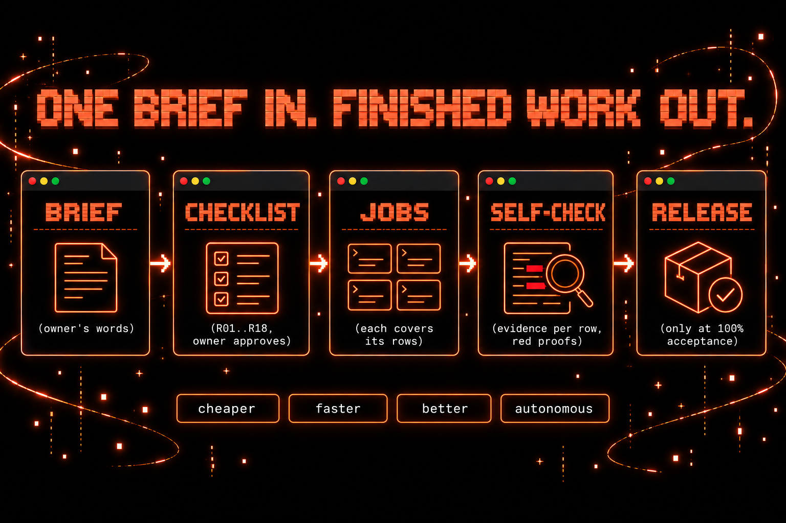

<p align="center"></p>

# Agent Jobs

> **Read in your language:** English (this page) · [**Русская версия →**](README.ru.md)

[](https://github.com/qwwiwi/agent-jobs/releases)
[](LICENSE)
[](go.mod)
[](https://code.claude.com/docs/en/headless)
[](#quick-start)
[](#license-and-author)

## One brief in. Finished work out.

**Agent Jobs turns one Claude Code session into a team lead.** You give the session a large task once. It writes briefs and hands the work to background `claude -p` *jobs*. Each job runs alone in its own git worktree, under hard limits and a guard, and comes back with a report. With the brief flow, the session checks the result against a checklist approved by the owner, and `release_check` passes the release only when every requirement is met. The owner answers the open questions and approves the checklist; everything else runs without them.

- **Cheaper.** Your subscription limits go further overall, because the main session orchestrates and keeps its own context lean. On one production agent, priced usage from transcripts ([real usage](docs/BENCHMARK.md#real-usage)) went from ≈ 14 subagent tasks to ≈ 146 jobs a day at about twice the daily dollars, and the main session's context per call fell from 390–560k to ≈ 265k tokens (an earlier auto-compact change also helped): this suggests far less limit use per task, though jobs are smaller tasks and limit burn itself was not recorded. A Claude job's spend is capped per attempt, with a $50 ceiling across attempts, and a single small job is not cheaper per task than a subagent ([benchmark](docs/BENCHMARK.md)).
- **Faster.** The session gets its turn back at once instead of waiting on a worker. Jobs run in parallel slots and queue the rest, and they survive a restart of the session or the daemon.
- **Better.** Every job is a full top-level Claude Code run with its own context and a fixed report contract. Large tasks are checked row by row against the owner's checklist, with evidence, by a blind judge; `release_check` passes only a judge that is blind by enforcement and of a different model family from the coders that delivered the work.
- **Autonomous.** Time limits on every job; on Claude jobs also turn and budget limits, a guard on every tool call and one automatic continuation after a turn-limit or timeout stop. Codex jobs run in the codex sandbox instead of the guard (read-only unless `codex_write_allowed`) and are neither continued nor resumed. Schedules and dead-man's switch checks run on their own. Jobs never push or publish: only the session does, after it has read the report and checked the diff.

It is a single Go binary with one SQLite file per agent. It runs on Linux (systemd user service) and macOS (launchd).

---

## Quick start

You need Go 1.27, git, the `claude` CLI and tmux (for the job-done line).

**1. Install (Linux).** One script builds the binary, installs the systemd user unit and the `agent-jobs` skill, initialises the agent and starts the daemon:

```bash
git clone https://github.com/qwwiwi/agent-jobs && cd agent-jobs
scripts/install-linux.sh --instance my-agent
systemctl --user status agent-jobs@my-agent
```

On macOS, build with `go build -o ~/.local/bin/agent-jobs ./cmd/agent-jobs`, run `agent-jobs init --agent my-agent` and load the launchd template: see [Install and configure](docs/GUIDE.md#install-and-configure).

**2. Tell it where your session lives.** In `~/.agent-jobs/my-agent/config.json`, name the tmux target of your Claude Code session, so the job-done line reaches it:

```json
{ "notify_tmux_target": "my-agent-session" }
```

The daemon reads this key only when it starts, so restart it before the first job (until then job-done lines go only to the daemon log):

```bash
systemctl --user restart agent-jobs@my-agent
```

On macOS, set it before you load the launchd job. Then edit `~/.agent-jobs/my-agent/owner-rules.md` (your standing rules for every job, ≤ 8 KB) and add `~/.agent-jobs/my-agent/orchestrator.md` (the main session's duties) to your agent's instructions.

**3. Give the session the tools.** The session drives jobs through an MCP server on stdio; register it in your session's MCP config:

```json
{ "mcpServers": { "agent-jobs": { "command": "agent-jobs", "args": ["mcp", "--role", "orchestrator", "--agent", "my-agent"] } } }
```

**4. Run a first job.** Ask the session to start one (`job_start`), or use the CLI:

```bash
agent-jobs start  --agent my-agent --title "review auth" --kind review \
  --repo ~/src/project --base main --complexity normal --brief-file brief.md   # prints the job id at once
agent-jobs list   --agent my-agent
agent-jobs result --agent my-agent <id>   # job-done line + report.md
```

Every job needs `--model` or `--complexity`. Full setup (all config keys, the shared brain, the HTTP API, upgrades, macOS): [docs/GUIDE.md → Install and configure](docs/GUIDE.md#install-and-configure).

---

## Why agent-jobs

**Delegate big tasks, not just small errands.** Anything longer than a few steps becomes a job: coding, fix loops, reviews, research, overnight work. A job gets its own git worktree, its own limits (default 80 turns, $10, 45 minutes for the first attempt), a guard on every tool call when it runs on Claude, and it must end with a report in a fixed format. Nobody has to watch it.

**Each job runs on its own.** A job is a separate process with a full context of its own. It commits locally; in a Claude job the guard blocks pushes, releases, PR and issue writes and messages to other sessions (the direct spellings: the guard is [not a sandbox](docs/GUIDE.md#safety)). It survives a restart of the session or the daemon. A Claude job stopped at its turn limit or timeout is continued once automatically, with half of its first limits again, and a stopped Claude job can be resumed in the same session with new instructions. A Codex job has no guard (the codex sandbox contains it, read-only unless `codex_write_allowed`) and is neither continued nor resumed.

<p align="center"></p>

**The main session orchestrates.** It talks to the owner, writes a brief for each job (a job has none of the conversation), starts it and goes back to work. When a job ends, it reads the report («Not done / uncertain» first), checks the diff against the base commit, decides, and only then pushes, merges or deploys. It is the only part that goes outside. Day-to-day routing and the pipeline are in [docs/WORKFLOW.md](docs/WORKFLOW.md).

**It saves context.** A subagent's result lands in the parent and is re-read on every following call until the next compaction. A job writes its result to a file, and the parent gets one line and reads the report when it is ready, so the long-lived session's window stays free for talking and deciding. The long-lived context is where the tokens go: over five days of real work, one agent's main session re-read about **7.2 billion** cached tokens, all of its subagents together about **2.3 billion** ([details](docs/GUIDE.md#why-jobs-not-subagents)).

**It saves time: work runs in parallel.** The session is never blocked by a worker. In the [benchmark](docs/BENCHMARK.md), the parent was busy 0.73 min per job against 1.65 min for a foreground subagent (0.47 min for a background one). Jobs run side by side in `max_running` slots per agent (default 2, up to 8), each in its own worktree, and the queue keeps the rest. To be fair, a single small job is neither cheaper nor quicker than a subagent: in the controlled benchmark it cost 28-35% more (priced total) and took two to three times longer, and priced against the coordinator's real main session it stayed about 38% more expensive per hand-off. The saving is at the level of the whole system (see «Cheaper» above): a lean main session that orchestrates many jobs, plus the free session, the hard caps, isolation, survival and parallel work. All the numbers are in [docs/BENCHMARK.md](docs/BENCHMARK.md).

---

## Large tasks: from one brief to a checked release

<p align="center"></p>

For a large task (a new project, or a feature with more than 5 requirements, several jobs or more than a day of work), the brief flow keeps the owner's words as the contract from start to finish. The session opts in with `checklist_init`; a `UserPromptSubmit` hook reminds it while a checklist decision is pending. A job's size is optional: `covers` imply `large`, otherwise `small` (config `size_required` makes every fix or general job declare it).

1. **Brief.** `checklist_init` saves the owner's words verbatim to `brief/BRIEF.md` in the project repository (secrets redacted). That text is frozen. Later words from the owner are added under `## Additions` as dated quotes.
2. **Checklist.** The session derives numbered rows in `brief/CHECKLIST.md` with `checklist_set`. Each row has an ID (`R01` from the brief, `R01i` implied, `G01` added later by the owner, `D01` a constraint), the brief quote it comes from, and a contract (`live`, `live placeholder-ok`, `deferred`, `dropped`).
3. **Questions.** Optionally, `briefing_start` runs a read-only job that prepares one or two rounds of at most four questions for the owner. Each question comes with a proposed answer and names the rows it settles.
4. **Blind slicing check.** `slicing_start` runs a read-only job that sees only the brief and the rows. It lists brief quotes that no row covers, quotes that are only half covered, and rows the brief does not support. It is advisory: approval does not need it, but once it ran, the owner must decide every uncovered quote it lists.
5. **Owner approval.** `checklist_set approve` stores the approval with the owner's words, bound to a hash of the rows and the brief. Any later edit voids it.
6. **Jobs check themselves against the rows.** Each feature job is started with `covers` (the row IDs it works on; `size: large` is then implied). The daemon writes the covered rows verbatim into the job's prompt. The job reports one line per requirement with its status and evidence (`R01 · done · file:line, the test`); a missing line is listed.
7. **Blind judge.** `judge_start` gives a read-only job a copy of the code at a commit, without history, diffs or reports. Before the judge starts, its wrapper runs the repository's `scripts/manifest-check.sh` on a separate copy of that commit (this needs config `acceptance_allowed: true`) and hands the judge the output. The judge returns a verdict per live requirement.
8. **Release only at 100%.** `release_check` passes only when every live requirement is met (or a placeholder on a `placeholder-ok` row, or waived by the owner for that requirement of the approved checklist; a later fix commit keeps the waiver), the manifest check exited 0, no brief quote is left uncovered and no test is suspect, and the judge was blind by enforcement and of another model family than the succeeded feature jobs. A Claude judge is held to its input by the guard; a Codex judge counts as blind when it ran under the read-only Codex sandbox (it blocks writes and network, not reads). So Claude coders are judged by a Codex model and Codex coders by a Claude model; failed, cancelled or small coders do not count for the family. It tells the owner «Acceptance: N of M». The optional `merge-gate` hook blocks a `gh pr merge` it can read in the session for an approved repository unless it names a head commit (`--match-head-commit`) on which that check passed; a command it cannot read runs with a warning. It is a guard rail, not a boundary (a `gh api` merge or the web UI pass by it).

Details: [Brief checklist, slicing, judge, release check](docs/GUIDE.md#mcp-tools) and [docs/PLAN.md](docs/PLAN.md) (Wave F).

---

## Features at a glance

| feature | what it is | why you want it |
|---|---|---|
| [Jobs](docs/GUIDE.md#how-it-works) | one-shot `claude -p` runs in their own git worktree, started by `job_start` or `agent-jobs start` | heavy work leaves the session; one line comes back |
| [Queue and limits](docs/GUIDE.md#limits) | at most `max_running` jobs per agent; turn, budget and time caps, with one automatic continuation at half the first limits (`auto_continue: false` turns it off) and $50 across all attempts; a model or complexity per job; explicit reasoning effort | parallel work with costs you can predict; over-limit requests are rejected, never clamped |
| [Amend, stop, resume](docs/GUIDE.md#change-course-amend-stop-and-resume) | add context to a queued job, stop a running one and keep its worktree and session, resume it with an update, automatic continuation once; resume and continuation are for Claude jobs | change course without losing what the job already knows |
| [Guard and safety](docs/GUIDE.md#safety) | deny rules and a parsing PreToolUse guard (Claude jobs; codex jobs: the codex sandbox), a scrubbed git environment, read-only review jobs, cgroup scopes on Linux, no nested jobs | a job's pushes, releases, PR writes and messages to people are blocked; only the session ships |
| [Report contract](docs/GUIDE.md#report-contract) | Summary, Findings / Changes, Evidence, Not done / uncertain, Progress; secrets redacted from reports | every result reads the same way, gaps first |
| [Cleanup and patches](docs/GUIDE.md#cleanup-and-patches) | worktrees removed 30 minutes after the job-done line, work kept as patches and a git ref; prune, log archive, per-job stats | disks stay clean and no work is lost |
| [Skills and job context](docs/GUIDE.md#skill-subagents-and-job-context) | the `agent-jobs` skill for the session; owner rules, project cards and catalog skills for jobs | the session routes work well, and jobs start with the right context |
| [Schedules](docs/GUIDE.md#mcp-tools) | cron in local time: type a prompt into the session or start a job | recurring work without a human |
| [Checks (dead-man's switch)](docs/GUIDE.md#mcp-tools) | work that is silent while healthy leaves a mark; a missed mark alerts the session | silent failures get noticed |
| [notify_owner](docs/GUIDE.md#mcp-tools) | a job or the session asks for the owner's attention through the session's own channel | jobs can raise a hand, with rate limits |
| [Owner waits](docs/GUIDE.md#mcp-tools) | a Stop hook holds the session's turn until it has replied to the owner about a job the owner asked for | the owner always hears back |
| [Heartbeat](docs/GUIDE.md#install-and-configure) | the daemon wakes the session for its own goals, outside a night window and within a daily cap | the agent moves its goals forward on its own |
| [Intentions](docs/GUIDE.md#mcp-tools) | the agent's own goals: add, list, set status | goals outlive a conversation |
| [Shared memory (brain)](docs/GUIDE.md#install-and-configure) | memory, task and team tools backed by the team's shared brain; memory notes in every brief | jobs and agents share what they learned |
| [Read-only HTTP API](docs/GUIDE.md#install-and-configure) | health, jobs, stats, schedules and skills over a unix socket or loopback, token required | build a dashboard without touching the database |
| [Codex runner](docs/GUIDE.md#limits) | a `gpt-*` model runs the job on `codex exec`; read-only by default, with a daily cap | a second model family for reviews and judging (a Codex judge under the read-only sandbox counts as blind for `release_check`) |
| [Brief flow](#large-tasks-from-one-brief-to-a-checked-release) | brief, checklist, briefing, slicing check, approval, covers, judge, release check, merge gate | large tasks from one brief, released only at 100% |
| [Doctor, logs, activity](docs/GUIDE.md#mcp-tools) | `system_doctor`, `system_logs`, `activity_report`, `agent-jobs doctor procs` | see what is wrong before it bites |
| [Trash](docs/GUIDE.md#mcp-tools) | reversible deletion inside configured roots: `trash_move`, `trash_restore` | delete without `rm` |

---

## How it works

<p align="center"></p>

The **main session** starts jobs and reviews their work. The **daemon** ticks once a minute. It launches queued jobs, collects finished ones, delivers job-done lines and cleans up, and it keeps no state in memory. The **queue** is one SQLite table per agent. Each **job** runs `claude -p` in its own process group and git worktree, and its **job folder** keeps the brief, settings, event stream, report and patches. **Schedules** and **checks** run on the same tick.

<p align="center"></p>

`job_start` queues the job and returns its id at once. The daemon launches it when a slot is free, and the job writes `report.md`. The session receives one line:

```
[jobs:job-done] job 261015-124136-70d3 review auth module succeeded · 3 turns · $0.25 · 0m · model sonnet · effort high
```

The session reads the report with `job_result`, checks the diff and pushes. Thirty minutes later the worktree is cleaned up and the work is kept as patches. When a repository job has commits, the line also says whether they merge cleanly onto its branch. The full lifecycle, the components and the merge check are in [docs/GUIDE.md → How it works](docs/GUIDE.md#how-it-works).

---

## Reference

Everything below the fold lives in [docs/GUIDE.md](docs/GUIDE.md), unabridged:

- [Why jobs, not subagents](docs/GUIDE.md#why-jobs-not-subagents), with the full benchmark table
- [How it works](docs/GUIDE.md#how-it-works): components, lifecycle, merge check, amend / stop / resume
- [Limits](docs/GUIDE.md#limits): defaults and ceilings, model by complexity, reasoning effort, codex runner, codex sandbox (`codex_sandbox`) and the AppArmor fix for its bwrap, acceptance command, kinds
- [Report contract](docs/GUIDE.md#report-contract): sections, off-contract reports, secret redaction, brief size
- [Cleanup and patches](docs/GUIDE.md#cleanup-and-patches): patches, prune, log archive, job stats, estimated cost, ghost processes
- [Safety](docs/GUIDE.md#safety): the full rule set, and why this is not a sandbox
- [Skill, subagents and job context](docs/GUIDE.md#skill-subagents-and-job-context): the skill, job profile, project cards, skills for jobs
- [MCP tools](docs/GUIDE.md#mcp-tools): jobs, memory, tasks and team, system and files, goals, schedules, checks, owner, hooks, brief checklist, job size, slicing, judge, release check, briefing, the full tool set
- [Install and configure](docs/GUIDE.md#install-and-configure): build, init, job context, every `config.json` key, shared brain, HTTP API, systemd, upgrade notes, launchd, the CLI, when a job fails
- [Release checklist](docs/GUIDE.md#release-checklist), [Versioning](docs/GUIDE.md#versioning), [Roadmap](docs/GUIDE.md#roadmap)

## Documentation

- [docs/GUIDE.md](docs/GUIDE.md): the full guide (the complete reference this README summarises)
- [docs/ARCHITECTURE.md](docs/ARCHITECTURE.md): internals, state layout, flows, the full rule list
- [docs/WORKFLOW.md](docs/WORKFLOW.md): working as an orchestrator: routing, the pipeline, review policy
- [docs/REFERENCE.md](docs/REFERENCE.md): the reference design, translated ([original in Russian](docs/REFERENCE.ru.md))
- [docs/DEVIATIONS.md](docs/DEVIATIONS.md): every approved deviation from the reference
- [docs/DECISIONS.md](docs/DECISIONS.md): owner decisions that shape scope
- [docs/PLAN.md](docs/PLAN.md): roadmap
- [docs/BENCHMARK.md](docs/BENCHMARK.md): subagent vs background subagent vs job benchmark and real-usage numbers
- [CHANGELOG.md](CHANGELOG.md)

Contributing: run `scripts/check.sh` (gofmt, go vet, go test) before a push; commit messages are English-only.

## Credits

Built on a reference design for orchestrating background `claude -p` jobs (see [docs/REFERENCE.md](docs/REFERENCE.md)).

## License and author

MIT (see [LICENSE](LICENSE)).

[@qwwiwi](https://github.com/qwwiwi) (Dashi Eshiev), Telegram channel «Записки AI-энтузиаста» · EdgeLab AI. Issues and PRs welcome.

Built together with [@qdanik](https://github.com/qdanik) (Daniil Yankouski), whose design is the [reference](docs/REFERENCE.md) this project follows.
