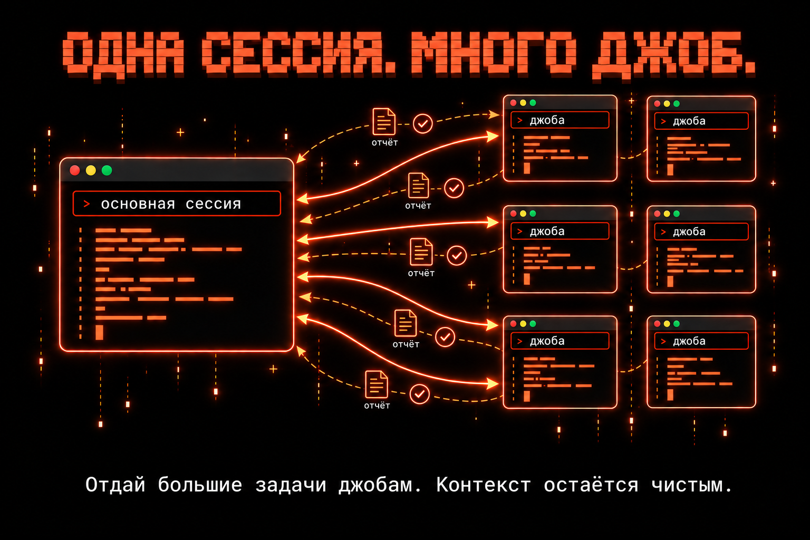
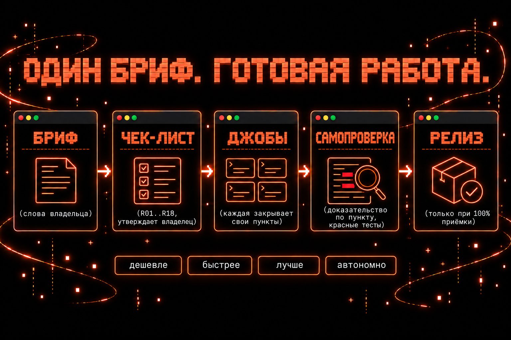
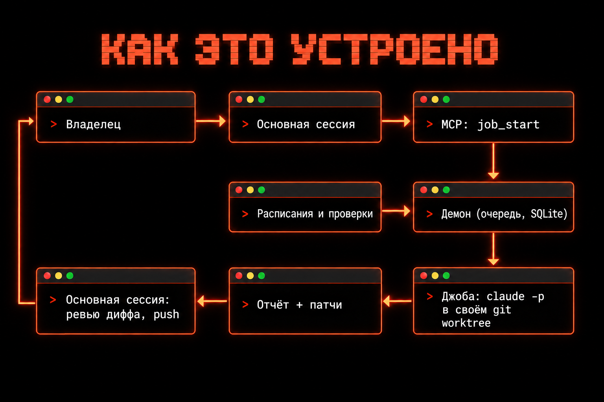
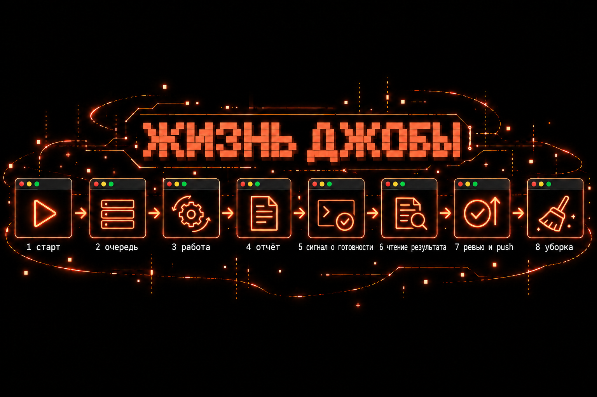

<p align="center"></p>

# Agent Jobs

> **Читать на своём языке:** [English →](README.md) · Русская версия (эта страница)

[](https://github.com/qwwiwi/agent-jobs/releases)
[](LICENSE)
[](go.mod)
[](https://code.claude.com/docs/en/headless)
[](#быстрый-старт)
[](#лицензия-и-автор)

## Один бриф на входе. Готовая работа на выходе.

**Agent Jobs превращает одну сессию Claude Code в тимлида.** Вы один раз ставите сессии большую задачу. Она пишет брифы и отдаёт работу фоновым *джобам* `claude -p`. Каждая джоба работает сама в своём git worktree, под жёсткими лимитами и гвардом, и возвращается с отчётом. В потоке брифа сессия сверяет результат с чек-листом, который утвердил владелец, и `release_check` пропускает релиз, только когда выполнено каждое требование. Владелец отвечает на открытые вопросы и утверждает чек-лист; всё остальное идёт без него.

- **Дешевле.** Лимиты подписки в целом тратятся экономнее, потому что главная сессия оркестрирует и держит свой контекст лёгким. На одном рабочем агенте расход в долларах по транскриптам ([реальная работа](docs/BENCHMARK.md#real-usage)) показал переход с ≈ 14 задач субагентов на ≈ 146 джоб в день примерно при двойном дневном расходе, а контекст главной сессии на вызов упал с 390–560k до ≈ 265k токенов (помогла и более ранняя смена окна автокомпакции): это говорит о намного меньшем расходе лимитов на задачу, хотя джобы — задачи мельче, а сам расход лимитов не записывался. Расходы джобы Claude ограничены на каждую попытку, с потолком $50 на все попытки, а одна маленькая джоба не дешевле субагента на задачу ([бенчмарк](docs/BENCHMARK.md)).
- **Быстрее.** Сессия сразу получает ход назад и не ждёт исполнителя. Джобы идут в параллельных слотах, остальные ждут в очереди, и они переживают перезапуск сессии или демона.
- **Лучше.** Каждая джоба — полноценный запуск Claude Code верхнего уровня со своим контекстом и фиксированным контрактом отчёта. Большие задачи проверяются по чек-листу владельца строка за строкой, с доказательствами и red proof. Проверяет слепой судья; `release_check` принимает только судью, слепого принудительно и из другого семейства моделей, чем кодеры.
- **Автономно.** Лимит времени на каждой джобе; у джоб Claude ещё лимиты на ходы и деньги, гвард на каждом вызове инструмента и одно автоматическое продолжение после остановки по лимиту ходов или таймауту. Джобы Codex вместо гварда работают в песочнице codex (только чтение, если не включён `codex_write_allowed`), не продолжаются и не возобновляются. Расписания и проверки dead-man's switch работают сами. Джобы никогда не пушат и не публикуют: это делает только сессия, после того как прочитала отчёт и проверила дифф.

Это один бинарник на Go и один файл SQLite на агента. Работает на Linux (пользовательская служба systemd) и macOS (launchd).

---

## Быстрый старт

Нужны Go 1.27, git, CLI `claude` и tmux (для строки о завершении джобы).

**1. Установка (Linux).** Один скрипт собирает бинарник, ставит пользовательский юнит systemd и скилл `agent-jobs`, инициализирует агента и запускает демон:

```bash
git clone https://github.com/qwwiwi/agent-jobs && cd agent-jobs
scripts/install-linux.sh --instance my-agent
systemctl --user status agent-jobs@my-agent
```

На macOS: соберите `go build -o ~/.local/bin/agent-jobs ./cmd/agent-jobs`, выполните `agent-jobs init --agent my-agent` и загрузите шаблон launchd, см. [Установка и настройка](docs/GUIDE.ru.md#установка-и-настройка).

**2. Укажите, где живёт сессия.** В `~/.agent-jobs/my-agent/config.json` укажите tmux-цель вашей сессии Claude Code, чтобы до неё доходила строка о завершении джобы:

```json
{ "notify_tmux_target": "my-agent-session" }
```

Демон читает этот ключ только при старте, поэтому перезапустите его до первой джобы (до тех пор строки о завершении попадают только в лог демона):

```bash
systemctl --user restart agent-jobs@my-agent
```

На macOS задайте его до загрузки задания launchd. Затем отредактируйте `~/.agent-jobs/my-agent/owner-rules.md` (ваши постоянные правила для каждой джобы, ≤ 8 КБ) и добавьте `~/.agent-jobs/my-agent/orchestrator.md` (обязанности главной сессии) в инструкции агента.

**3. Дайте сессии инструменты.** Сессия управляет джобами через MCP-сервер на stdio; зарегистрируйте его в MCP-конфиге сессии:

```json
{ "mcpServers": { "agent-jobs": { "command": "agent-jobs", "args": ["mcp", "--role", "orchestrator", "--agent", "my-agent"] } } }
```

**4. Первая джоба.** Попросите сессию её запустить (`job_start`) или воспользуйтесь CLI:

```bash
agent-jobs start  --agent my-agent --title "review auth" --kind review \
  --repo ~/src/project --base main --complexity normal --brief-file brief.md   # сразу печатает id джобы
agent-jobs list   --agent my-agent
agent-jobs result --agent my-agent <id>   # строка о завершении + report.md
```

Каждой джобе нужен `--model` или `--complexity`. Полная настройка (все ключи конфига, общий мозг, HTTP API, обновления, macOS): [docs/GUIDE.ru.md → Установка и настройка](docs/GUIDE.ru.md#установка-и-настройка).

---

## Зачем agent-jobs

**Делегируйте большие задачи, а не только мелкие поручения.** Всё, что дольше нескольких шагов, становится джобой: код, циклы исправлений, ревью, исследования, ночная работа. У джобы свой git worktree, свои лимиты (по умолчанию 80 ходов, $10, 45 минут на первую попытку) и, если она идёт на Claude, гвард на каждом вызове инструмента. В конце она обязана сдать отчёт в фиксированном формате. Следить за ней никому не нужно.

**Каждая джоба работает сама.** Джоба — отдельный процесс с собственным полным контекстом. Она коммитит локально. В джобе Claude гвард блокирует пуши, релизы, запись в PR и issues и сообщения другим сессиям (в прямом написании: гвард — [не песочница](docs/GUIDE.ru.md#безопасность)). Джоба переживает перезапуск сессии или демона. Джоба Claude, остановленная по лимиту ходов или таймауту, один раз продолжается автоматически, снова с половиной первых лимитов, а остановленную джобу Claude можно продолжить в той же сессии с новыми указаниями. У джобы Codex гварда нет (её держит песочница codex, только чтение, если не включён `codex_write_allowed`), и она не продолжается и не возобновляется.

<p align="center"></p>

**Главная сессия оркестрирует.** Она разговаривает с владельцем, пишет каждой джобе бриф (разговора джоба не видит), запускает её и возвращается к работе. Когда джоба закончилась, сессия читает отчёт (сначала «Not done / uncertain») и проверяет дифф от базового коммита. Только после этого она решает и пушит, мержит или деплоит. Наружу выходит только она. Маршрутизация и конвейер на каждый день: [docs/WORKFLOW.ru.md](docs/WORKFLOW.ru.md).

**Экономит контекст.** Результат субагента попадает в родителя и перечитывается на каждом следующем вызове до ближайшей компакции. Джоба пишет результат в файл, а родитель получает одну строку и читает отчёт, когда готов. Так окно долгоживущей сессии остаётся свободным для разговора и решений. Токены уходят именно на долгоживущий контекст: за пять дней реальной работы главная сессия одного агента перечитала из кеша около **7,2 млрд** токенов, а все её субагенты вместе — около **2,3 млрд** ([подробнее](docs/GUIDE.ru.md#почему-джобы-а-не-субагенты)).

**Экономит время: работа идёт параллельно.** Исполнитель никогда не блокирует сессию. В [бенчмарке](docs/BENCHMARK.md) родитель был занят 0,73 мин на джобу против 1,65 мин для субагента на переднем плане (0,47 мин для фонового). Джобы идут рядом в `max_running` слотах на агента (по умолчанию 2, до 8), каждая в своём worktree, остальные ждут в очереди. Честно: одна маленькая джоба не дешевле и не быстрее субагента. В контролируемом бенчмарке она обошлась на 28–35% дороже (по расчётной стоимости) и шла в два-три раза дольше, а в расчёте на реальной главной сессии координатора осталась примерно на 38% дороже за одну передачу. Экономия — на уровне всей системы (см. «Дешевле» выше): лёгкая главная сессия, которая оркестрирует много джоб, а ещё свободная сессия, жёсткие лимиты, изоляция, живучесть и параллельная работа. Все цифры: [docs/BENCHMARK.md](docs/BENCHMARK.md).

---

## Большие задачи: от одного брифа до проверенного релиза

<p align="center"></p>

Для большой задачи (новый проект или фича с более чем 5 требованиями, несколькими джобами или работой дольше дня) поток брифа держит слова владельца контрактом от начала до конца. Сессия включает его через `checklist_init`. Хук `UserPromptSubmit` может ей об этом напоминать, а ключ конфига `size_required` заставляет каждую джобу fix или general объявлять свой размер.

1. **Бриф.** `checklist_init` дословно сохраняет слова владельца в `brief/BRIEF.md` в репозитории проекта (секреты замаскированы). Этот текст заморожен. Более поздние слова владельца добавляются под `## Additions` как цитаты с датой.
2. **Чек-лист.** Сессия выводит из брифа пронумерованные строки `brief/CHECKLIST.md` через `checklist_set`. У каждой строки есть ID (`R01` из брифа, `R01i` подразумеваемое, `G01` добавлено владельцем позже, `D01` ограничение), цитата из брифа, из которой она взята, и контракт (`live`, `live placeholder-ok`, `deferred`, `dropped`).
3. **Вопросы.** По желанию `briefing_start` запускает read-only джобу. Она готовит для владельца один-два раунда не больше чем по четыре вопроса. У каждого вопроса есть предложенный ответ, и он называет строки, которые закрывает.
4. **Слепая проверка нарезки.** `slicing_start` запускает read-only джобу, которая видит только бриф и строки. Она перечисляет цитаты брифа, которые не покрыты ни одной строкой, цитаты, покрытые наполовину, и строки, которых нет в брифе. По каждой непокрытой цитате владелец обязан принять решение.
5. **Утверждение владельцем.** `checklist_set approve` сохраняет утверждение со словами владельца и привязывает его к хешу строк и брифа. Любая последующая правка его аннулирует.
6. **Джобы проверяют себя по строкам.** Каждая джоба фичи запускается с `covers` (ID строк, над которыми работает) и `size: large`. Демон дословно вписывает покрытые строки в промпт джобы. Джоба отчитывается строкой по каждому требованию: доказательство, выполненная команда и red proof (тест, который падал до изменения). Строка `done` без них попадает в список *заявленных*, а не выполненных; пропущенная строка тоже попадает в список.
7. **Слепой судья.** `judge_start` даёт read-only джобе копию кода на коммите, без истории, диффов и отчётов. Перед судьёй её обёртка запускает `scripts/manifest-check.sh` репозитория на отдельной копии этого коммита (нужен ключ конфига `acceptance_allowed: true`) и передаёт судье вывод. Судья выносит вердикт по каждому live-требованию.
8. **Релиз только при 100%.** `release_check` пропускает, только когда выполнено каждое live-требование (или это заглушка на строке `placeholder-ok`, или владелец снял его именно для этого коммита). Кроме того, manifest check должен завершиться с кодом 0, все цитаты брифа должны быть покрыты, подозрительных тестов быть не должно, судья должен быть слепым принудительно и из другого семейства моделей, чем кодеры, а каждое требование — прослеживаться до джобы фичи. Сегодня оба условия для судьи выполняет только одна комбинация: судью Claude держит на его входе гвард, судью Codex — нет (его вердикт хранится с `enforced_blind: false` и носит только рекомендательный характер), поэтому кодерами должны быть джобы фичи на Codex (ключ конфига `codex_write_allowed: true`), а судьёй — модель Claude. Работа, написанная Claude, пока `release_check` не проходит. Владельцу он сообщает «Acceptance: N of M». Необязательный хук `merge-gate` блокирует `gh pr merge` в сессии для утверждённого репозитория, если в команде не указан head-коммит (`--match-head-commit`), на котором эта проверка прошла. Это перила, а не граница: мерж через `gh api` или веб-интерфейс мимо него проходит.

Подробности: [чек-лист брифа, нарезка, судья, release check](docs/GUIDE.ru.md#mcp-тулы) и [docs/PLAN.ru.md](docs/PLAN.ru.md) (волна F).

---

## Возможности кратко

| возможность | что это | зачем это вам |
|---|---|---|
| [Джобы](docs/GUIDE.ru.md#как-это-работает) | одноразовые запуски `claude -p` в своём git worktree, через `job_start` или `agent-jobs start` | тяжёлая работа уходит из сессии, назад приходит одна строка |
| [Очередь и лимиты](docs/GUIDE.ru.md#лимиты) | не больше `max_running` джоб на агента; лимиты на ходы, деньги и время, одно автопродолжение с половиной первых лимитов (`auto_continue: false` его выключает) и $50 на все попытки; модель или сложность на каждую джобу; явный reasoning effort | параллельная работа с предсказуемыми затратами; запрос выше лимита отклоняется, а не урезается |
| [Дополнить, остановить, продолжить](docs/GUIDE.ru.md#сменить-курс-дополнить-остановить-продолжить) | дополнить джобу в очереди, остановить идущую с сохранением worktree и сессии, продолжить её с новыми указаниями, одно автопродолжение; продолжение и автопродолжение — для джоб Claude | смена курса без потери того, что джоба уже знает |
| [Гвард и безопасность](docs/GUIDE.ru.md#безопасность) | deny-правила и PreToolUse-гвард с разбором команд (джобы Claude; у джоб Codex — песочница codex), очищенное git-окружение, read-only ревью-джобы, cgroup-scope на Linux, никаких вложенных джоб | пуши, релизы, запись в PR и сообщения людям из джобы заблокированы; выпускает только сессия |
| [Контракт отчёта](docs/GUIDE.ru.md#контракт-отчёта) | Summary, Findings / Changes, Evidence, Not done / uncertain, Progress; секреты вычищаются из отчётов | каждый результат читается одинаково, пробелы — первыми |
| [Чистка и патчи](docs/GUIDE.ru.md#чистка-и-патчи) | worktree удаляется через 30 минут после строки о завершении, работа хранится патчами и git-ref; prune, архив логов, статистика по джобам | диск чистый, работа не теряется |
| [Скиллы и контекст джобы](docs/GUIDE.ru.md#скилл-субагенты-и-контекст-джобы) | скилл `agent-jobs` для сессии; правила владельца, карточки проектов и скиллы из каталога для джоб | сессия правильно маршрутизирует работу, а джобы стартуют с нужным контекстом |
| [Расписания](docs/GUIDE.ru.md#mcp-тулы) | cron по местному времени: напечатать промпт в сессию или запустить джобу | регулярная работа без человека |
| [Проверки (dead-man's switch)](docs/GUIDE.ru.md#mcp-тулы) | работа, которая молчит, пока здорова, оставляет отметку; пропущенная отметка поднимает тревогу в сессии | тихие сбои не проходят незамеченными |
| [notify_owner](docs/GUIDE.ru.md#mcp-тулы) | джоба или сессия зовёт владельца через собственный канал сессии | джоба может поднять руку, с ограничением частоты |
| [Владелец ждёт](docs/GUIDE.ru.md#mcp-тулы) | Stop-хук держит ход сессии, пока она не ответила владельцу о джобе, которую он заказывал | владелец всегда получает ответ |
| [Heartbeat](docs/GUIDE.ru.md#установка-и-настройка) | демон будит сессию ради её собственных целей, вне ночного окна и в пределах дневного лимита | агент сам двигает свои цели |
| [Свои цели](docs/GUIDE.ru.md#mcp-тулы) | собственные цели агента: добавить, перечислить, сменить статус | цели переживают разговор |
| [Общая память (мозг)](docs/GUIDE.ru.md#установка-и-настройка) | тулы памяти, задач и команды поверх общего мозга команды; заметки памяти в каждом брифе | джобы и агенты делятся тем, что узнали |
| [HTTP API только для чтения](docs/GUIDE.ru.md#установка-и-настройка) | health, джобы, статистика, расписания и скиллы через unix-сокет или loopback, нужен токен | дашборд без доступа к базе |
| [Раннер Codex](docs/GUIDE.ru.md#лимиты) | модель `gpt-*` запускает джобу на `codex exec`; по умолчанию только чтение, с дневным лимитом | второе семейство моделей для ревью и рекомендательного судейства (вердикт Codex не слепой принудительно, поэтому `release_check` его не принимает) |
| [Поток брифа](#большие-задачи-от-одного-брифа-до-проверенного-релиза) | бриф, чек-лист, вопросы, проверка нарезки, утверждение, covers, судья, release check, merge gate | большие задачи с одного брифа, релиз только при 100% |
| [Doctor, логи, активность](docs/GUIDE.ru.md#mcp-тулы) | `system_doctor`, `system_logs`, `activity_report`, `agent-jobs doctor procs` | видно, что не так, до того как это ударит |
| [Корзина](docs/GUIDE.ru.md#mcp-тулы) | обратимое удаление внутри заданных корней: `trash_move`, `trash_restore` | удаление без `rm` |

---

## Как это работает

<p align="center"></p>

**Главная сессия** запускает джобы и проверяет их работу. **Демон** тикает раз в минуту. Он запускает джобы из очереди, собирает завершённые, доставляет строки о завершении и подчищает, а состояния в памяти не держит. **Очередь** — одна таблица SQLite на агента. Каждая **джоба** запускает `claude -p` в своей группе процессов и своём git worktree, а в её **папке** лежат бриф, настройки, поток событий, отчёт и патчи. **Расписания** и **проверки** работают на том же тике.

<p align="center"></p>

`job_start` ставит джобу в очередь и сразу возвращает её id. Демон запускает её, когда освобождается слот, и джоба пишет `report.md`. Сессия получает одну строку:

```
[jobs:job-done] job 261015-124136-70d3 review auth module succeeded · 3 turns · $0.25 · 0m · model sonnet · effort high
```

Сессия читает отчёт через `job_result`, проверяет дифф и пушит. Через тридцать минут worktree убирается, а работа сохраняется патчами. Если у джобы в репозитории есть коммиты, строка ещё говорит, сливаются ли они с её веткой без конфликтов. Полный жизненный цикл, компоненты и проверка слияния: [docs/GUIDE.ru.md → Как это работает](docs/GUIDE.ru.md#как-это-работает).

---

## Справочник

Всё, что ниже, без сокращений лежит в [docs/GUIDE.ru.md](docs/GUIDE.ru.md) (английский оригинал: [docs/GUIDE.md](docs/GUIDE.md)):

- [Почему джобы, а не субагенты](docs/GUIDE.ru.md#почему-джобы-а-не-субагенты), с полной таблицей бенчмарка
- [Как это работает](docs/GUIDE.ru.md#как-это-работает): компоненты, жизненный цикл, проверка слияния, дополнить / остановить / продолжить
- [Лимиты](docs/GUIDE.ru.md#лимиты): значения по умолчанию и потолки, модель по сложности, reasoning effort, раннер Codex, команда приёмки, виды джоб
- [Контракт отчёта](docs/GUIDE.ru.md#контракт-отчёта): разделы, отчёты вне контракта, вычистка секретов, размер брифа
- [Чистка и патчи](docs/GUIDE.ru.md#чистка-и-патчи): патчи, prune, архив логов, статистика джоб, оценка стоимости, процессы-призраки
- [Безопасность](docs/GUIDE.ru.md#безопасность): полный набор правил и почему это не песочница
- [Скилл, субагенты и контекст джобы](docs/GUIDE.ru.md#скилл-субагенты-и-контекст-джобы): скилл, профиль джобы, карточки проектов, скиллы для джоб
- [MCP-тулы](docs/GUIDE.ru.md#mcp-тулы): джобы, память, задачи и команда, система и файлы, цели, расписания, проверки, владелец, хуки, чек-лист брифа, размер джобы, нарезка, судья, release check, вопросы, полный набор тулов
- [Установка и настройка](docs/GUIDE.ru.md#установка-и-настройка): сборка, init, контекст джобы, все ключи `config.json`, общий мозг, HTTP API, systemd, заметки об обновлении, launchd, CLI, что делать, если джоба упала
- [Чеклист релиза](docs/GUIDE.ru.md#чеклист-релиза), [Версии](docs/GUIDE.ru.md#версии), [План](docs/GUIDE.ru.md#план)

## Документация

- [docs/GUIDE.ru.md](docs/GUIDE.ru.md): полное руководство (весь справочник, который кратко пересказывает этот README; [на английском](docs/GUIDE.md))
- [docs/ARCHITECTURE.md](docs/ARCHITECTURE.md): устройство, раскладка состояния, потоки, полный список правил (на английском)
- [docs/WORKFLOW.ru.md](docs/WORKFLOW.ru.md): работа в роли оркестратора: маршрутизация, конвейер, политика ревью ([на английском](docs/WORKFLOW.md))
- [docs/REFERENCE.ru.md](docs/REFERENCE.ru.md): эталонный дизайн, оригинал ([английский перевод](docs/REFERENCE.md))
- [docs/DEVIATIONS.md](docs/DEVIATIONS.md): все одобренные отличия от эталона
- [docs/DECISIONS.md](docs/DECISIONS.md): решения владельца, задающие объём работ
- [docs/PLAN.ru.md](docs/PLAN.ru.md): план ([на английском](docs/PLAN.md))
- [docs/BENCHMARK.md](docs/BENCHMARK.md): бенчмарк «субагент, фоновый субагент, джоба» и цифры реального использования (на английском)
- [CHANGELOG.md](CHANGELOG.md)

Участие: перед пушем запускайте `scripts/check.sh` (gofmt, go vet, go test); сообщения коммитов только на английском.

## Благодарности

Построено на эталонном дизайне оркестрации фоновых джоб `claude -p` (см. [docs/REFERENCE.ru.md](docs/REFERENCE.ru.md)).

## Лицензия и автор

MIT (см. [LICENSE](LICENSE)).

[@qwwiwi](https://github.com/qwwiwi) (Даши Ешиев), Telegram-канал «Записки AI-энтузиаста» · EdgeLab AI. Issues и PR приветствуются.

Сделано вместе с [@qdanik](https://github.com/qdanik) (Даниил Янковский): его схема – [референс](docs/REFERENCE.ru.md), по которому построен проект.
