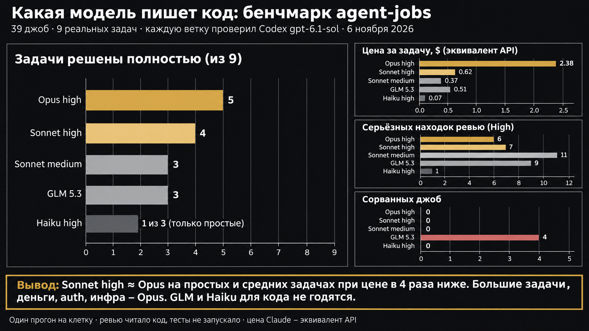
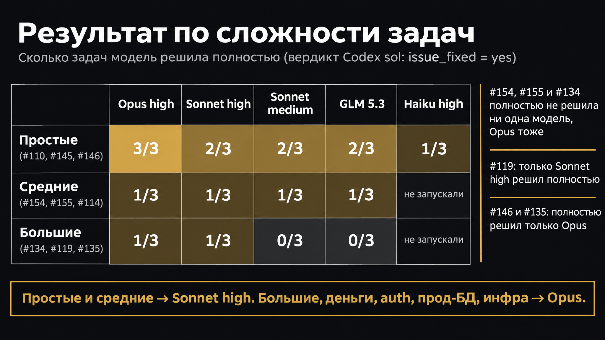
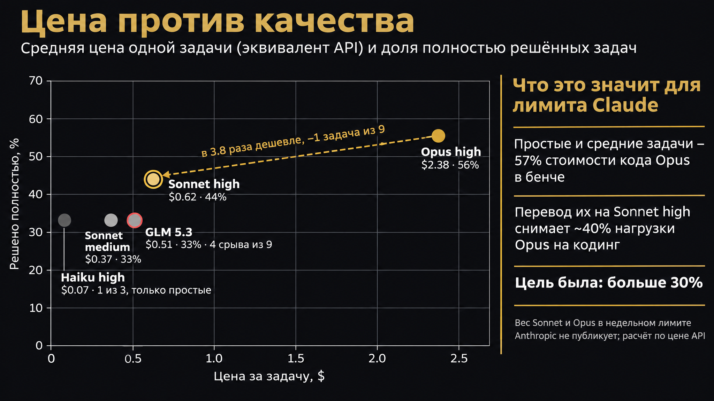
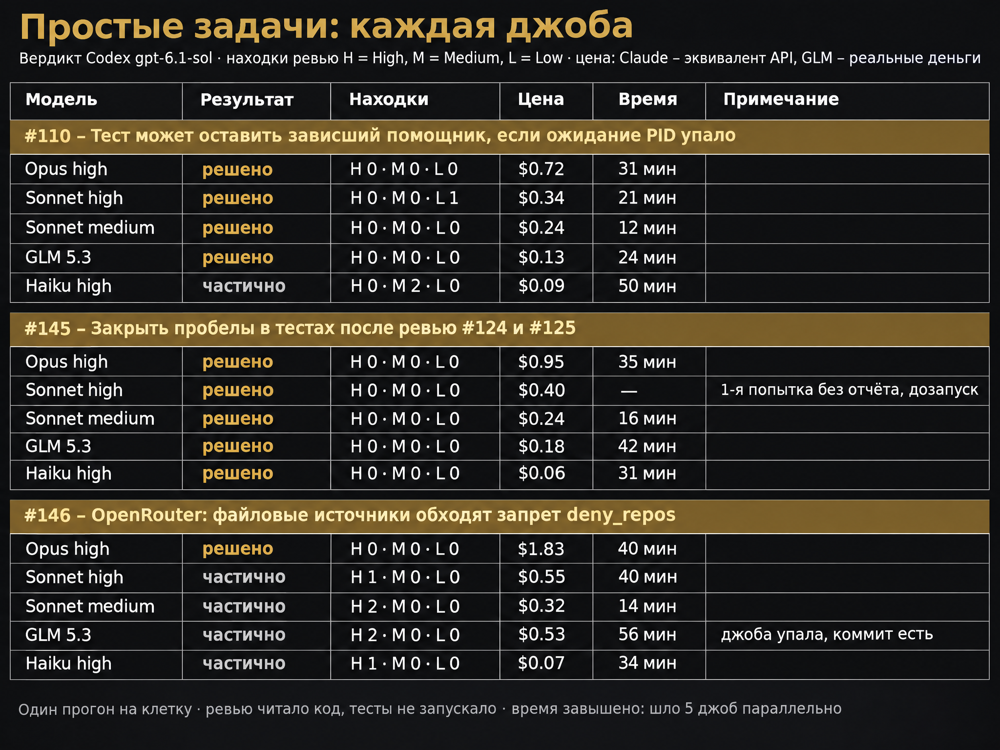
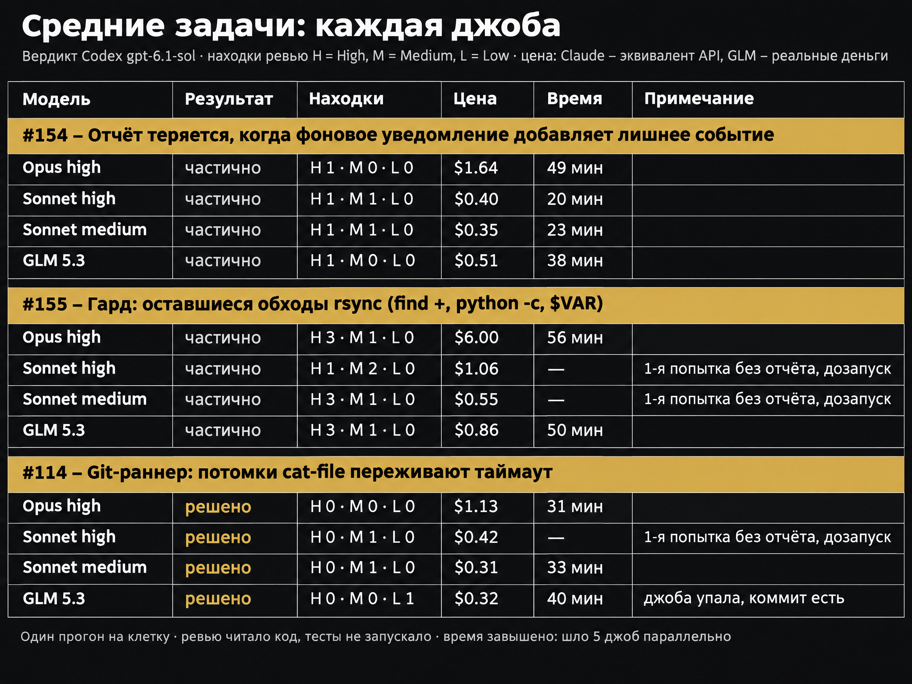
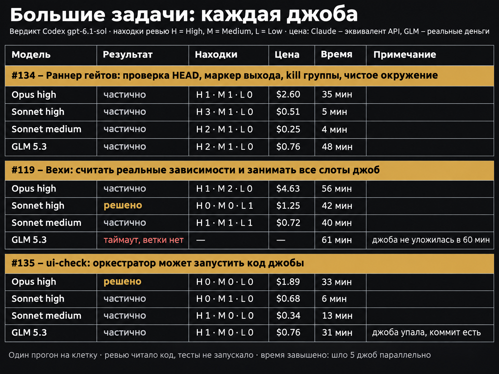

# Model benchmark 2026-11-06: all artifacts

The write-up (results, method, caveats, routing) is [../2026-11-06-models.md](../2026-11-06-models.md). This folder holds everything behind it.

Task sizes and what each of the nine tasks asked for: [../2026-11-06-models.md#what-the-task-sizes-mean](../2026-11-06-models.md#what-the-task-sizes-mean).

## Charts

Generated with `gpt-image-2.6-sunburst` at 2K from the data below (prompts in `scripts/charts/`). Chart labels are in Russian; every number was checked against `data/results.md`. One drawing slip: on the summary chart the Haiku bar is longer than its value, the label «1 из 3» is correct.

| Chart | What it shows |
|---|---|
|  | Fully fixed tasks per model, cost per task, High findings, failed jobs |
|  | Fully fixed by task size (small / medium / large) |
|  | Cost against share fully fixed; what the routing frees on Opus |
|  | Every job on the small tasks (#110, #145, #146) |
|  | Every job on the medium tasks (#154, #155, #114) |
|  | Every job on the large tasks (#134, #119, #135) |

## Contents

| Path | What |
|---|---|
| `data/manifest.tsv` | 39 rows: level, issue, model tag, coder job id |
| `data/results.md` | Per job: status, turns, cost, seconds, sol verdict |
| `issues/` | The nine issue texts as given to the coders |
| `briefs/` | The exact brief of every coder job (issue + fixed task rules) |
| `review-briefs/` | The exact brief of every `gpt-6.1-sol` review job |
| `reports/*-coder.md` | Each coder job's report |
| `reports/*-review.md` | Each review job's report, ending with `BENCH-VERDICT` |
| `patches/*.patch` | Each branch's diff against base `8f6e8f9` (GLM #119 timed out with no branch) |
| `scripts/launch.sh` | Queues the 39 coder jobs |
| `scripts/review-watch.sh` | Starts one sol review per finished coder job |
| `scripts/collect.py` | Builds `data/results.md` from the job statuses and verdicts |
| `scripts/charts/` | Chart generator (`gen.py`), detail-table prompt builder, all prompts |

Local paths and the agent name are replaced by placeholders such as `<bench-dir>` and `<agent>`. The bench branches were not pushed; the patches are the full record of the code each model wrote.
